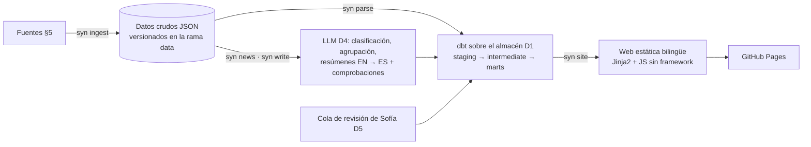

# SCOPE — SYNAPTICA

> **Fuente de verdad** de qué se hace, en qué orden y por qué. Si otro documento lo contradice, manda este. Los cambios se registran en §11.
>
> **Versión 100** · 2026-11-13 · creada a partir de la propuesta aprobada por Sofía (`docs/propuesta.md`).

## Índice

1. Visión
2. Objetivos
3. Dentro y fuera del alcance
4. Secciones de la web
5. Fuentes de datos
6. Arquitectura (propuesta)
7. Fases y entregables
8. Decisiones
9. Riesgos y mitigaciones
10. Backlog
11. Registro de cambios

## 1. Visión

**SYNAPTICA** («your Neuroscience hub» / «tu portal de neurociencia») es una web gratuita, en español e inglés, que cada día recoge lo nuevo de la neurociencia y lo explica de forma sencilla. A eso suma secciones para aprender cómo funciona el cerebro: un atlas 3D, técnicas de laboratorio, enfermedades, historia, experimentos y glosario.

Está pensada para dos públicos a la vez: gente curiosa sin formación y estudiantes. La firman Aday y Sofía.

**Posicionamiento.** El proyecto más parecido es [The Folded Mind](https://thefoldedmind.com/en/): atlas 3D del cerebro humano, biblioteca y boletín semanal, en turco e inglés y con enfoque de neuropsiquiatría clínica (diagnósticos, medicación, sistemas emocionales). SYNAPTICA se diferencia en:
- **Neurociencia básica y traslacional:** cómo se investiga el cerebro y qué se aprende en animales, no la clínica.
- **El puente rata ↔ humano** en Neuro Atlas: la misma región en los dos cerebros, con su grado de equivalencia y lo aprendido en cada especie.
- **Actualización diaria y automática**, en español e inglés.

Para no solaparse: nada de fichas de medicamentos, ni sistemas emocionales o cortes de resonancia como función principal; Neuro Diseases se centra en enfermedades neurológicas. Nunca se reutilizan sus textos ni su diseño. Aprobado por Sofía (v13).

## 2. Objetivos

**Producto.** Que Sofía tenga una web fiable de su campo que se mantenga sola. Cada frase sale de una fuente, y el contenido de salud pasa por su revisión.

**Portfolio de Aday (ingeniería de datos).**
- Demostrar que el motor de Paleo Atlas se generaliza: el mismo diseño, funcionando en otro dominio.
- Repetir dbt, Python, pytest y GitHub Actions, que ya aparecen en Paleo Atlas.
- Añadir lo que falta en el CV: un almacén en la nube (decisión D1) y, si se justifica con medidas, procesamiento a escala (D6).
- Evaluar con rigor: el clasificador de noticias se mide contra etiquetas puestas por Sofía, doctoranda en neurociencia.

**Métricas que se irán registrando:** artículos procesados por día, porcentaje de textos verificados, precisión del clasificador frente a Sofía, duración del pipeline diario y coste (0 €).

## 3. Dentro y fuera del alcance

**Dentro**
- Las 8 secciones de §4, en español e inglés.
- Actualización diaria automática de las noticias y de los bloques «lo último» de cada sección.
- Borradores automáticos de los textos fijos a partir de Wikipedia y Wikidata, con las comprobaciones de Paleo Atlas y la revisión de Sofía.

**Fuera** (no se hace salvo cambio registrado en §11)
- Consejo médico de cualquier tipo, recomendaciones de tratamiento, fichas de medicamentos y herramientas de autodiagnóstico.
- Reutilizar textos o diseño de otros proyectos (por ejemplo, The Folded Mind).
- Cuentas de usuario, comentarios públicos, publicidad y cualquier uso comercial.
- Copiar abstracts o textos completos de artículos de pago.
- Airflow, Docker y Snowflake.

## 4. Secciones de la web

| Sección | Qué es | Se actualiza sola | Revisión de Sofía | Fase |
|---|---|---|---|---|
| Neuro News | Noticias en tres bloques: Última hora, Nature · Science · Cell y Clásicos. Resumen semanal. | Sí (los Clásicos los aprueba ella) | Elige los Clásicos cada semana | 1 |
| Neuro Atlas | Cerebro humano y de rata en 3D; al tocar una región: qué hace, enfermedades relacionadas y últimos estudios. La misma región en los dos cerebros, lado a lado, con su grado de equivalencia; estudios en animales frente a estudios en humanos; técnicas con las que se estudia | Los estudios de cada región | Textos de cada región, correspondencia región → términos de búsqueda y **grado de equivalencia rata ↔ humano** | 2 |
| Neuro Lab | Técnicas: perfusiones, western blot, inmunofluorescencia, microscopía confocal, electrofisiología, EEG, fMRI, trazado con vectores virales, optogenética, DREADDs y quimiogenética, fiber photometry | Los estudios de ejemplo | Borradores de cada técnica | 2 |
| Neuro Glossary | Términos y siglas de la A a la Z, con buscador y enlaces a regiones, técnicas y enfermedades | No | Definiciones y siglas de su trabajo | 2 |
| Neuro Learn | Explicaciones cortas (neurona, sinapsis, sentidos, memoria, sueño…) y un apartado de neuromitos | No | Temas y borradores | 3 |
| Neuro Diseases | Fichas de enfermedades neurológicas (no un catálogo de diagnósticos psiquiátricos), línea del tiempo de estudios y ensayos clínicos abiertos en España | Estudios y ensayos | **Obligatoria** antes de publicar | 3 |
| Neuro History | Línea del tiempo desde Ramón y Cajal hasta hoy, con los Nobel relacionados | Cada Nobel nuevo | Hitos que no pueden faltar | 4 |
| Neuro Experiments | Ilusiones ópticas, pruebas en pantalla (tiempo de reacción, memoria…) y vídeos seleccionados | No | Propuestas de experimentos y vídeos | 4 |

Además, en todas las fases: dato curioso del día, página «Cómo elegimos y comprobamos las fuentes», «Estado de los datos», «Fuentes y licencias» y «Acerca de».

Las ideas nuevas van dentro de una sección existente, nunca como sección propia (es una condición de Sofía).

## 5. Fuentes de datos

En la Fase 0 se verifica el acceso, los límites, si hace falta clave y la licencia de cada fuente (spike S1); el resultado va a `docs/fuentes.md`.

| Fuente | Para qué | Fase |
|---|---|---|
| PubMed (E-utilities) | Estudios nuevos de neuro; estudios por región, técnica y enfermedad | 1 |
| Europe PMC | Texto completo en acceso abierto, para resúmenes más ricos | 1 |
| bioRxiv / medRxiv | Preprints, marcados como «sin revisar» | 1 |
| Nature, Science, Cell y revistas hermanas (Nature Neuroscience, Neuron…) | Bloque propio en Neuro News; solo metadatos y enlaces | 1 |
| SINC (sección Noticias), The Conversation, ScienceDaily (Neuroscience) | Noticias de divulgación en español e inglés | 1 |
| Crossref | Retractaciones, correcciones, tipo de publicación | 1 |
| OpenAlex | Recuento de citas para proponer los Clásicos | 1 |
| Wikipedia (ES/EN) y Wikidata | Borradores de los textos fijos, enfermedades por región, Nobel | 2–4 |
| Julich-Brain · siibra-explorer (EBRAINS) | Atlas humano (CC BY-NC-SA 4.0) y visor (Apache-2.0) | 2 |
| Waxholm Space, rata v4.01 | Atlas de rata (delineaciones CC BY 4.0; la RM de plantilla, CC BY-SA 4.0) | 2 |
| Allen Institute · BrainGlobe Atlas API | Alternativas y mallas 3D (licencias por confirmar) | 2 |
| ClinicalTrials.gov | Ensayos abiertos en España | 3 |
| nobelprize.org | Verificación de los Nobel y altas nuevas (ver si tiene API o se usa Wikidata) | 4 |
| Wikimedia Commons | Imágenes con licencia y autor | 1–4 |

## 6. Arquitectura (propuesta)

Confirmada en la Fase 0 con D1, D3, D4 y D5, todas cerradas: DuckDB con espejo en BigQuery, visor Niivue, Groq con juez de otra familia y revisión por Issues de GitHub. Sigue el diseño de Paleo Atlas.

- El estado vive en git. El almacén se reconstruye en cada ejecución, así que cualquier día es reproducible.
- Cada paso es un comando `syn`. GitHub Actions los ejecuta a diario, con una detección de cambios barata primero y una ejecución de respaldo.
- Cada ejecución deja un informe en la rama `data`.

## 7. Fases y entregables

Cada fase se cierra con el **visto bueno de Sofía** y con `docs/fases/fase-N.md`: el porqué, los conceptos, cómo se comprueba, qué salió mal y cómo defenderlo en una entrevista. Al acabar cada fase la web sigue publicada, aunque falten secciones.

### Fase 0 — Cimientos (cerrada el 2026-11-13)

- [x] Repositorio `synaptica` en local y en GitHub (visibilidad: D9)
- [x] `pyproject.toml` (uv, Python 3.14, ruff, pytest), `.gitignore`, `.editorconfig`, `.python-version`
- [x] CLI `syn` mínima (typer) con `syn --version` y `syn doctor`, que comprueba el entorno y las variables necesarias
- [x] CI (`ci.yml`): ruff y pytest sin red en cada push y PR
- [x] `LICENSE` (AGPL-3.0) y `LICENSE-CONTENT.md` (CC BY-SA 4.0 para los textos propios; terceros con su licencia), según §8
- [x] `README.md` y `README.es.md` mínimos
- [x] `docs/adr/README.md` con plantilla y `docs/fases/README.md`
- [x] `docs/propuesta.md`, exportada del documento aprobado
- [x] **S1 Fuentes:** script mínimo por fuente que descarga unos 10 elementos, guardados como fixtures, y `docs/fuentes.md` con acceso, límites, clave y licencia
- [x] **S2 Almacén:** prueba de BigQuery sandbox desde GitHub Actions con dbt-bigquery → ADR de D1
- [x] **S3 Visor 3D:** dos maquetas (three.js con mallas propias y Niivue con volúmenes propios; siibra-explorer embebido, medido y descartado) con los dos atlas lado a lado y regiones clicables por ID, en GitHub Pages; entre las que cumplan D3 elige Sofía ([plan](spikes/s3/PLAN.md)) → ADR de D3. Hechos los pasos 0 (preparación), 1 (datos y licencias, [resultados](spikes/s3/results/README.md)), 2 (maqueta A, descartada: [resultados](spikes/s3/results/maqueta-a.md)), 3 (datos para B y C, [resultados](spikes/s3/results/README.md#s3--paso-3-datos-para-las-maquetas-b-y-c)), 4 (maqueta B, borrada el 2026-11-11 tras elegir Sofía C), 5 (maqueta C, `spikes/s3/site/c/`) y 6 (mediciones: [B](spikes/s3/results/maqueta-b.md), [C](spikes/s3/results/maqueta-c.md)). Sofía elige C y pide ajustes ([peticiones](spikes/s3/results/peticiones-sofia.md)): pasos 7.1–7.10 antes del ADR. Hechos el 7.1, el 7.2 (paleta) el 7.3 (corte sincronizado), el 7.4 (clic sincronizado), el 7.5 (mm desde Bregma, cráneo plano) el 7.6 (modos y atlas en blanco y negro), el 7.7 (tinción dibujada) y el 7.8 (tinción real: BigBrain en el humano; la rata, al backlog). Antes del 7.9, las mejoras de UX y UI de Aday: hechas la M1 (buscador de áreas) y la M2 (el punto marca el área). Hechos el 7.9 (móvil) y el 7.10 ([publicada en Pages](https://adaycuestacorrea.github.io/synaptica/spikes/s3/c/)). Revisión de Sofía (2026-11-12): conservar las dos tinciones; al humano le faltaban el cerebelo, el tronco y la médula → CerebrA como segunda capa ([cobertura](spikes/s3/results/cobertura.md)); tinción real de rata: no existe en 3D; se muestra en el corte 2D con los cortes de Nissl registrados de Blixhavn 2023 ([tinción](spikes/s3/results/tincion.md)). Sofía da por buena la maqueta → [ADR de D3](docs/adr/0003-visor.md), aceptado el 2026-11-13
- [x] **S4 Revisión:** prototipo del flujo de revisión probado con Sofía ([plan](spikes/s4/PLAN.md)) → [ADR de D5](docs/adr/0005-revision.md)
- [x] **S5 LLM:** límites actuales del plan gratuito de Groq y de Ollama local, y elección de un juez de otra familia de modelos para el contenido de salud → ADR de D4

**Cierre:** CI en verde, D1, D3, D4 y D5 cerradas con su ADR, y `docs/fuentes.md` completo.

### Fase 1 — La base

[Plan](docs/fases/plan-fase-1.md): 30 pasos en cuatro rebanadas verticales. Se programa desde el cierre de la Fase 0 (2026-11-13); los pasos que no necesitaban a Sofía ni GitHub se adelantaron en la rama `fase-1` (excepción de las v54–v56). Una casilla se marca cuando se cumple el «Hecho cuando» de sus pasos en el plan; si el código está hecho pero falta algo, lo dice la nota en cursiva.

- [ ] Ingesta de las fuentes de la Fase 1 (§5) en la rama `data`, con caché y respeto de límites. *Código hecho (pasos 3–8); falta escribir en la rama `data` (paso 28) y las retractaciones que solo conoce Retraction Watch.*
- [x] Modelos dbt con tests: claves, valores aceptados, relaciones y frescura de cada fuente
- [x] Filtro «¿es neurociencia?» para las revistas generalistas (paso 13, medido en la v69; la comparación con las etiquetas de Sofía va con el 14b)
- [ ] Clasificación por tipo (cerebro sano, enfermedades, ensayos clínicos, técnicas, ruido), evaluada contra unos 100 titulares etiquetados por Sofía y un baseline clásico. *Código hecho (14a); faltan las etiquetas de Sofía (14b) y una ejecución real.*
- [ ] Agrupación de la misma noticia entre medios e idiomas. *Código hecho (15) y probado con FakeLLM; faltan la precisión y el recall de los pares con un LLM real.*
- [x] Resúmenes EN → ES con las comprobaciones de texto (pasos 16 y 17; probado con FakeLLM, sin ejecución real todavía)
- [x] Repetir la cadena de S5 con los prompts v2 (Groq, y Qwen 9B cuando la GPU de Aday quede libre) y comprobaciones nuevas (ortografía en español, frases de alarma, cautelas), comparando con la revisión de Sofía ([ADR D4](docs/adr/0004-llm.md))
- [ ] Juez de otra familia (D4) y carga inicial de resúmenes con el modelo local de Aday, cuando el PC quede libre de los lotes de Paleo; después, Groq en Actions. *El juez está hecho (19); falta la carga inicial (20).*
- [x] Señales de cada estudio: publicado en revista o preprint (ver «Cómo evaluamos»), humanos o animales, retractado o corregido (paso 12; que se vean en cada página lo comprueba `syn site --check`, paso 21; falta Retraction Watch, ver la primera casilla)
- [ ] Bloques Última hora · Nature, Science y Cell · Clásicos (propuesta semanal por citas en OpenAlex y aprobación de Sofía). *Hechos Última hora y Nature · Science · Cell (paso 23) y la propuesta de Clásicos (24a); falta que Sofía elija los primeros (24b).*
- [x] Resumen semanal (texto, paso 25; página en ES y EN, paso 23; sin ejecución real todavía, así que muestra el texto de respaldo)
- [x] Web: portada y diseño, aviso médico, dato curioso del día, Cómo evaluamos, Estado de los datos, Fuentes y licencias, Acerca de; bilingüe y con `syn site --check`. *Pasos 21, 22, 23 y 26; publicada en https://adaycuestacorrea.github.io/synaptica/ el 2026-11-13 (paso 27).*
- [x] `pipeline.yml`: ejecución diaria con detección de cambios, respaldo e informe. *Paso 28: primera ejecución en verde el 2026-11-13, a mano y sin LLM; la primera con Groq es la programada del 2026-11-14.*
- [x] Espejo semanal de los marts en BigQuery sandbox (D1), con su consumo de cupo medido en el informe. *Paso 29: código y pipeline; el primer espejo real espera el OK de Aday.*

**Cierre:** 14 días seguidos de ejecución autónoma sin intervención, visto bueno de Sofía y `fase-1.md`. El reloj cuenta desde la ejecución programada del 2026-11-14 (v121); para cerrar hacen falta también todas las casillas.

### Fase 2 — Prioridades de Sofía

- [ ] **Neuro Atlas:** humano (Julich-Brain) y rata (Waxholm) en 3D según D3, cada atlas por separado y con su licencia
  - [ ] **Estudio de UX y UI de Neuro Atlas**, antes de construirlo, a partir de las [notas de la maqueta de S3](spikes/s3/results/notas-ux.md) y de la revisión de Sofía
  - [ ] Pasar el script de datos del visor (`spikes/s3/build_assets.py`) a `src/synaptica/atlas/` con tests y reescribir el visor en `site/static/` ([ADR D3](docs/adr/0003-visor.md); en la Fase 1 la portada enlaza al prototipo de S3)
  - [ ] **Introducción:** diferencias generales entre el cerebro humano y el de rata (girencéfalo frente a lisencéfalo, proporciones, etc.), con la cadena de textos y revisada por Sofía
  - [ ] Orden de las regiones: primero las estructuras de la superficie y después las internas (hipocampo, amígdala…), según propone Sofía
  - [ ] Cada región con nombre y código oficial; al tocarla, descripción, enfermedades relacionadas (Wikidata) y últimos estudios
  - [ ] Tabla región → términos de búsqueda y sinónimos para PubMed, revisada por Sofía
  - [ ] **Rata ↔ humano:** tabla de correspondencias entre regiones de Waxholm y de Julich-Brain con grado de equivalencia (clara, parcial o discutida) y una nota breve, puesta por Sofía; vista lado a lado de la misma región en los dos atlas, sin mezclar sus datos (licencias distintas)
  - [ ] **Qué hemos aprendido en animales:** en cada región, estudios en roedores y estudios en humanos por separado, con las etiquetas de §4
  - [ ] **Técnica ↔ región:** desde cada región, las técnicas de Neuro Lab con las que se estudia; desde cada técnica, las regiones donde se usa (a partir de los estudios clasificados)
- [ ] **Neuro Lab:** una ficha por técnica de §4 (qué permite ver, límites y estudios recientes que la usan)
- [ ] **Neuro Glossary:** términos y siglas de la A a la Z, buscador y enlaces cruzados; semilla con los 16 términos de la propuesta y borradores desde Wikipedia; en Neuro Atlas, al tocar o pasar por la sigla de una región, su definición, nombre completo y sigla (petición P6 de S3)

**Cierre:** visto bueno de Sofía y `fase-2.md`.

### Fase 3 — Aprender

- [ ] **Neuro Learn:** temas elegidos por Sofía y el apartado de neuromitos
- [ ] **Neuro Diseases:** fichas (lista de Sofía), línea del tiempo de estudios y ensayos abiertos en España; publicación bloqueada sin aprobación registrada
- [ ] Enlaces cruzados Atlas ↔ Diseases ↔ Glossary ↔ News

**Cierre:** visto bueno de Sofía y `fase-3.md`.

### Fase 4 — Para explorar

- [ ] **Neuro History:** línea del tiempo interactiva; la tabla de Nobel de la propuesta como semilla, verificada; altas automáticas de Nobel nuevos con filtro neuro y aprobación; hitos no Nobel elegidos por Sofía
- [ ] **Neuro Experiments:** ilusiones y pruebas en JS sin framework, cada una con explicación verificada; vídeos insertados con permiso de inserción
- [ ] Comparador de cerebros dentro de Neuro Atlas, solo si hay datos fiables y con licencia (si no, se queda en el backlog)

**Cierre:** visto bueno de Sofía y `fase-4.md`.

## 8. Decisiones

### Cerradas

| Decisión | Motivo |
|---|---|
| Nombre SYNAPTICA, a nombre de Aday y Sofía | Elegido por Sofía (dominio pendiente: D7) |
| Español e inglés desde el principio | Respuesta de Sofía; mismo patrón que Paleo Atlas |
| 8 secciones de §4 y orden de fases de §7 | Propuesta aprobada; las prioridades de Sofía van en la Fase 2 |
| La sección del atlas se llama «Neuro Atlas» | «Brain Explorer» figura como marca del Allen Institute |
| Se aceptan licencias NC | Decisión de Aday: la web es gratuita y no comercial |
| 0 € al mes | Mismo principio que Paleo Atlas |
| Revisión obligatoria de Sofía en Neuro Diseases | Contenido de salud |
| Textos fijos como borradores desde Wikipedia que Sofía corrige | Aprobado por Sofía; tiene 1 h al día |
| Python + dbt + GitHub Actions + Pages; estado en git | Se repite el motor de Paleo Atlas |
| Sin Airflow, Docker ni Snowflake | Los dos primeros ya están demostrados; Snowflake no es gratis |
| Posicionamiento frente a The Folded Mind (§1): neurociencia básica y traslacional, puente rata ↔ humano, sin medicación | Propuesto por Aday y aprobado por Sofía; aprovecha su investigación en roedores y evita duplicar un proyecto clínico |
| Licencias: código AGPL-3.0; textos propios CC BY-SA 4.0; material de terceros con la suya (NC incluidas) | El código comparte motor con Paleo Atlas (AGPL), y una licencia más abierta anularía esa protección. Los textos parten de Wikipedia (CC BY-SA) y así pueden reutilizarse e incluso volver a ella. Los textos nunca incorporan material de los atlas NC. |
| Repositorio público en GitHub; Sofía no es colaboradora por ahora | Por el portfolio, y en público Actions no tiene límite de minutos y Pages es gratis. Sofía entra como colaboradora solo si el flujo de revisión (D5) lo necesita |
| D1 · Almacén: DuckDB reconstruido cada día; espejo semanal de los marts en BigQuery sandbox (load jobs, WIF) | S2: el sandbox funciona sin tarjeta, pero su cupo de 10 GiB es de por vida y no se recupera al borrar, así que no aguanta una reconstrucción diaria. El espejo suma BigQuery al CV sin poner en riesgo el pipeline ([ADR D1](docs/adr/0001-almacen.md)) |
| D2 · Motor común con Paleo Atlas: copiar y adaptar cada módulo, con su origen en el docstring; sin paquete compartido por ahora | Paleo está en producción y no se toca desde aquí, y el dominio de SYNAPTICA aún cambia piezas que parecían genéricas. Se revisa al cerrar la Fase 1 ([ADR D2](docs/adr/0002-motor-comun.md)) |
| D3 · Visor 3D: Niivue 0.69 con volúmenes de etiquetas propios, uno por atlas, servido desde la web; rata Waxholm y humano Julich-Brain con capas debajo (CerebrA, CIT168, sustancia blanca de ICBM 2009c); tinción dibujada o real (BigBrain en el humano; Nissl en el corte 2D de la rata) ([ADR](docs/adr/0003-visor.md)) | S3: todo el atlas clicable sin una malla por región, corte 2D sincronizado de serie, sin otros dominios ni seguimiento; ~2,5 MB y ~19 s en móvil con red lenta. Elegida por Sofía, revisada por ella y cerrada por Aday (2026-11-13) |
| D4 · LLM: carga inicial con el modelo local de Aday (Qwen 9B en Ollama); después, Groq gratis en Actions con redactor `qwen3.8-27b` y juez `gpt-oss-120b` (otra familia) | S5: Groq da unos 40–60 resúmenes al día por modelo, y el juez de otra familia cazó 3 errores reales que las comprobaciones dejaban pasar. La carga inicial va en local para no gastar cupo; se hace cuando terminen los lotes de Paleo ([ADR D4](docs/adr/0004-llm.md)) |
| D5 · Revisión: página de revisión generada cada día y envío como Issue de GitHub; un workflow valida autor, versión y comprobaciones y lo añade a un registro en la rama `data` ([ADR](docs/adr/0005-revision.md)) | S4, probado con Sofía en 3 rondas (2026-11-12): sin terminal ni git, cumple los criterios salvo el tiempo de la primera ronda (38 min, con más trabajo del pedido); prefiere esto a una hoja de cálculo y no le importa que sus decisiones sean públicas. La prueba destapó 6 fallos, corregidos |
| D10 · Pipeline diario: la caché privada (abstracts, uso del LLM) se guarda entre ejecuciones en la caché de Actions, nunca en git; un 429 de cupo diario para el comando sin reintentar; `syn doctor --llm groq` comprueba la clave antes del LLM y pone la ejecución en rojo si falla; el espejo de D1 va los lunes con `continue-on-error` | Una ejecución en rojo significa algo que hay que mirar, y agotar el cupo no lo es. Así «14 días sin intervención» se puede medir ([ADR](docs/adr/0010-pipeline-diario.md), v119) |
| Cupo diario de resúmenes: prioridad por niveles y, dentro de cada uno, lo más nuevo primero: (1) neurociencia de Nature · Science · Cell y sus hermanas; (2) estudios que la agrupación une a una noticia de los medios; (3) el resto de lo publicado en revista; (4) preprints. Lo que no entra muestra el texto de respaldo | Decisión de Aday (v98) sobre la pregunta abierta de la v72: S5 da 40–60 resúmenes al día por modelo frente a unos 470 candidatos. Es determinista, se prueba sin red y gasta el cupo en lo que la web enseña primero; la carga inicial en local (paso 20) recupera atrasos. *Nota (v103): el nivel 2 queda vacío hasta que algo enlace un estudio con una noticia; la agrupación del paso 15 solo une noticias entre sí y los feeds no traen DOI (decisión de Aday: opción A, ver backlog).* |
| La señal `review_status = journal` se muestra como «Publicado en revista» / «Published in a journal», no como «revisado por pares» | Decisión de Aday (v98): ni Crossref ni PubMed dicen de forma fiable si hubo revisión por pares; «Cómo evaluamos» lo explica. El nombre final lo confirma Sofía |
| Buscador de la maqueta en la Fase 1, con el paso 23; el glosario se queda en la Fase 2 (§4) | Decisión de Aday (v100): el buscador solo busca lo que la web ya tiene (estudios, noticias, páginas), sin contenido nuevo ni revisión; el glosario tiene definiciones solo en español y sin revisar, y no puede existir en un idioma sin el otro. Cuando entre el buscador, vuelve de Paleo la comprobación del índice de búsqueda |

### Abiertas

| ID | Decisión | Opciones | Recomendación inicial |
|---|---|---|---|
| D6 | Procesamiento a escala | Databricks Free Edition para una carga histórica de PubMed · solo APIs | Solo si el volumen lo justifica y se mide, como en el ADR D5 de Paleo. Si no, basta OpenAlex |
| D7 | Dominio | Dominio propio · `adaycuestacorrea.github.io/synaptica` | Empezar en GitHub Pages y comprobar el nombre antes de registrar nada (ya existe Synaptica B.V., una empresa neerlandesa de neurociencia computacional) |

## 9. Riesgos y mitigaciones

| Riesgo | Mitigación |
|---|---|
| El tiempo de Sofía (1 h al día) se convierte en un cuello de botella | Cola de revisión priorizada; solo Neuro Diseases bloquea la publicación |
| El tiempo de Aday: las candidaturas de empleo van primero | Fases cortas y la web siempre publicada; ninguna fase depende de una fecha |
| ~~Nature, Science o Cell sin un canal público útil~~ **Mitigado** (S1, 2026-11-09) | Los 7 RSS de las revistas y sus hermanas funcionan y traen DOI; Crossref por ISSN queda de respaldo (ISSN impreso para Cell Press). Ver `docs/fuentes.md` |
| Visor 3D pesado o imposible sin backend | S3 en la Fase 0, antes de comprometer la Fase 2 |
| Los nombres de las regiones dan resultados ambiguos en PubMed | Tabla de sinónimos revisada por Sofía y tests con ejemplos |
| La tabla de equivalencias rata ↔ humano consume demasiado tiempo de Sofía | Empezar por las regiones de su investigación y las más consultadas; el resto se muestra sin vista comparada hasta que tenga su grado |
| Cambian los límites de los planes gratuitos (LLM, APIs) | Caché, ejecución por lotes y degradación al texto de respaldo. Ya pasó: Groq retiró Llama del plan gratuito (S5). Los papeles de redactor y juez se pueden intercambiar entre las dos familias que quedan, y Ollama recupera los atrasos |
| GitHub retrasa o se salta las ejecuciones programadas | Ejecución de respaldo y detección de cambios, como en Paleo |

## 10. Backlog

Ideas sin aprobar; entran en una fase solo con una línea en §11.

- Comparador de cerebros entre especies, si no entra en la Fase 4.
- Resumen semanal por correo.
- Pares estudio–noticia para el nivel 2 del cupo: candidatos por fecha y parecido del título, decididos por el LLM con caché, como una ampliación del paso 15 con su evaluación (v103).
- ~~Título de cada estudio en español: una salida más de la cadena de `syn write` (prompt v3) que pase las comprobaciones; hasta entonces, el original con un hueco (v101).~~ **Entra en la Fase 1 como paso 23c** (v122), con un comando aparte.
- Tinción real de rata en el visor: un volumen en Waxholm montado a partir de cortes registrados uno a uno: el atlas Timm-Nissl de EBRAINS (Nissl, CC BY 4.0) o Zhao et al. 2024 (plata de cuerpos celulares, como BigBrain, CC BY-NC-SA 4.0) ([S3](spikes/s3/results/tincion.md)).
- Humano en Neuro Atlas: lo que ninguna capa etiqueta todavía ([cobertura](spikes/s3/results/cobertura.md)): la médula (PAM50, otra rejilla, licencia de datos por confirmar), el tronco dividido (la división de FreeSurfer no tiene licencia publicada), el bulbo olfatorio (sin atlas MNI) y los tractos de la sustancia blanca (atlas ENIGMA, CC BY 4.0, fibras en la plantilla 2009a).

## 11. Registro de cambios

| Versión | Fecha | Cambio |
|---|---|---|
| 1 | 2026-11-09 | Creación a partir de la propuesta aprobada por Sofía |
| 2 | 2026-11-09 | D8 cerrada: código AGPL-3.0 y textos propios CC BY-SA 4.0 |
| 3 | 2026-11-09 | Andamiaje de la Fase 0 hecho (repo, pyproject, CLI `syn` con `--version` y `doctor`, CI, licencias, README, índices de ADR y fases); D9 cerrada: repositorio público, Sofía no es colaboradora hasta que D5 lo pida |
| 4 | 2026-11-09 | Nuevo spike S5 (LLM) para cerrar D4, que el cierre de la Fase 0 exige y ningún spike cubría; D5 anota que Sofía no tiene cuenta de GitHub; GitHub Pages activado (origen: GitHub Actions) |
| 5 | 2026-11-09 | S1 en curso: `docs/fuentes.md` con 15 fuentes medidas y fixtures sin texto de editores; los RSS de Nature, Science y Cell funcionan; pendientes SINC (caído), algunos límites y los atlas (en S3) |
| 6 | 2026-11-09 | §9: riesgo «Nature, Science o Cell sin canal público» mitigado según S1 |
| 7 | 2026-11-09 | S2 hecho: BigQuery sandbox funciona desde Actions sin tarjeta ni clave (WIF), pero tiene un cupo de almacenamiento de 10 GiB de por vida que no se recupera al borrar, incompatible con reconstruir el almacén cada día. ADR D1 en propuesta (recomendación: DuckDB + espejo semanal de los marts en BigQuery) |
| 8 | 2026-11-09 | D1 cerrada (opción C): DuckDB como almacén y espejo semanal de los marts en BigQuery; tarea del espejo añadida a la Fase 1 |
| 9 | 2026-11-10 | S5 hecho: límites de Groq medidos (1000 RPD y 8000 TPM por modelo; 200 000 TPD documentado; sin Llama), Qwen 9B local a 122 tokens/s y la cadena de Paleo probada con 10 artículos de PubMed (8–9 de 10 publicables; el juez de otra familia cazó 3 errores reales que las comprobaciones dejaban pasar). ADR D4 en propuesta (recomendación: opción A); D4 sigue abierta |
| 10 | 2026-11-10 | D4 cerrada (opción A): carga inicial con el modelo local de Aday cuando terminen los lotes de Paleo, y después Groq en Actions con juez de otra familia. Revisión de una muestra de resúmenes preparada para Sofía |
| 11 | 2026-11-10 | Revisión ciega de Sofía de los resúmenes de S5 (20 versiones): Qwen 9B y Qwen 27B empatan en contenido (los prefiere 4 y 5 veces) y en los dos el español es el punto débil. El juez coincide con ella en 17 de 19 casos (kappa ≈ 0,60): deja pasar una exageración y rechaza una versión que ella da por buena. D4 no cambia; cifras en la sección «Revisión» del [ADR D4](docs/adr/0004-llm.md) |
| 12 | 2026-11-10 | Prompts de S5 en v2 según la revisión de Sofía (diseño del estudio, lista de exageraciones, término técnico con explicación, español natural; nota `spanish_natural` del juez, que no bloquea). La nueva ejecución queda pendiente, como tarea de la Fase 1 |
| 13 | 2026-11-11 | Posicionamiento frente a The Folded Mind (§1), aprobado por Sofía: en la Fase 2 entran la vista rata ↔ humano con grado de equivalencia, «qué hemos aprendido en animales» y los enlaces técnica ↔ región; D3 exige los dos atlas lado a lado; Neuro Diseases se centra en enfermedades neurológicas; fuera del alcance, fichas de medicamentos y reutilizar textos o diseño ajenos |
| 14 | 2026-11-11 | D5: el flujo de revisión también tiene que cubrir la tabla de equivalencias rata ↔ humano (grado y nota); la página de revisión de S5 cuenta como primera prueba de la opción «página de revisión generada» |
| 15 | 2026-11-11 | Plan de S3 ([`spikes/s3/PLAN.md`](spikes/s3/PLAN.md)): dos maquetas lado a lado (siibra-explorer y three.js) en GitHub Pages, y elige Sofía; regiones de prueba: una de superficie y el hipocampo. Fase 2, a propuesta de Sofía: introducción a las diferencias entre el cerebro humano y el de rata, y regiones de la superficie antes que las internas |
| 16 | 2026-11-11 | S3, pasos 0 y 1: grupo `spike-s3` (brainglobe-atlasapi, siibra, trimesh) y medidas de los dos atlas ([resultados](spikes/s3/results/README.md)). Waxholm es v4.01 (224 regiones, mallas de 16,8 MB sin comprimir) y Julich-Brain v3.1 (MPM de 1 mm, sin mallas: hay que generarlas). Las tres regiones de prueba existen en los dos atlas; la amígdala de Waxholm no está subdividida. `docs/fuentes.md` completa la línea de los atlas, lo último de S1. **Por decidir:** las delineaciones de Waxholm son CC BY 4.0, no CC BY-SA como dicen §5, CLAUDE.md, la propuesta y el plan (solo la RM de plantilla es CC BY-SA); no se ha corregido en esos documentos |
| 17 | 2026-11-11 | Licencia de Waxholm corregida a CC BY 4.0 en §5, CLAUDE.md, la propuesta y el plan de S3, según el EBRAINS KG (v4 y v4.01) y NITRC; la RM de plantilla es CC BY-SA 4.0. Se mantiene la regla de no combinar los dos atlas en un mismo dato derivado |
| 18 | 2026-11-11 | CLAUDE.md: los textos propios de Paleo Atlas (CC BY-NC-SA) no se copian a SYNAPTICA (CC BY-SA), se reescriben; el código se sigue copiando (AGPL en los dos) |
| 19 | 2026-11-11 | S3, paso 2 ([maqueta A](spikes/s3/results/maqueta-a.md)): siibra-explorer se deja embeber y abre con una región seleccionada desde la URL, pero no avisa a la página que lo embebe; solo un plugin propio (`?pl=`), que el usuario tiene que aprobar en cada visita, podría reenviar el clic, y no se ha podido probar sin publicarlo en HTTPS. 6,8 MB de código antes de los datos, interfaz de escritorio en móvil y Matomo de EBRAINS activado por defecto |
| 20 | 2026-11-11 | Plan de S3 cambiado ([`spikes/s3/PLAN.md`](spikes/s3/PLAN.md)): la maqueta A (siibra-explorer) queda descartada y la sustituye la C, Niivue 0.69.0 con volúmenes propios; Sofía elegirá entre B (three.js) y C. Nuevo paso común de datos para las dos y requisito añadido: sin ventanas, sin seguimiento y sin otros dominios en tiempo de uso. Pages pasa a ser el paso 7 |
| 21 | 2026-11-11 | S3, paso 3: `spikes/s3/build_assets.py` genera, por atlas y sin mezclarlos, un glTF con Draco (B), un NIfTI de etiquetas (C), la tabla de nombres y colores y la licencia con su cita; unos 0,8 MB por atlas. Waxholm a 117 µm, con protección de regiones pequeñas (decisión de Aday: sin ella se pierde CC L). Julich-Brain distingue los hemisferios por archivo (lh/rh), no por coordenada. `equivalencias.json` de prueba con el grado «pendiente de Sofía». Dependencias declaradas en `spike-s3`: dracopy, fast-simplification, nibabel, scikit-image y scipy |
| 22 | 2026-11-11 | S3, paso 4: maqueta B (three.js 0.187.0 y su decodificador Draco, guardados en `spikes/s3/site/vendor/` con sus licencias). Dos lienzos (uno encima del otro en móvil); al hacer clic, panel con ID y lado, resaltado de la equivalente en el otro atlas con el grado «pendiente de Sofía», y botones para ocultar el contorno o aislar la región. Corregidos en `build_assets.py`: el corte de las mallas de rata por lado (cara a cara) y la orientación de las caras. Es + en, con `?lang=en` |
| 23 | 2026-11-11 | S3, paso 5: maqueta C (Niivue 0.69.0, guardado en `spikes/s3/site/vendor/` con su licencia, que el paquete de npm no trae). Con el mismo comportamiento que B, más dos vistas (solo 3D, y 3D con un corte coronal), recortar y aislar. Hubo que sortear dos cosas de Niivue: en 3D solo lee el vóxel con doble clic (un clic simple le manda ese doble clic), y con unas 450 etiquetas su tabla de colores pintaba el fondo con la etiqueta 3 (se suben las etiquetas 8 valores al cargar, solo en el visor) |
| 24 | 2026-11-11 | S3, paso 6: mediciones de B y C en un móvil emulado (Slow 4G, CPU ×4, táctil) con `spikes/s3/measure.mjs`. Con gzip, como en Pages: B pesa 1,07 MB y se puede usar a los 10 s; C, 1,91 MB y 16 s. Las dos funcionan con el dedo y no piden nada a otros dominios. Fluidez con WebGL por software: B, 20 fps; C, 3 fps a DPR 3 y 22 fps con `?dpr=1`. Falta probar las dos en un móvil real |
| 25 | 2026-11-11 | S1 hecho. SINC vuelve a responder y se usa su sección *Noticias* (decisión de Aday): unos 1,2 items de neuro por semana, incluye casi todo lo de Salud y añade la neuro animal de *Tierra*. medRxiv psiquiatría: 34 preprints en 7 días al paginar; las semanas pasadas crecen días después y cada versión es una entrada aparte (habrá que volver atrás y deduplicar por DOI). Límites: solo Europe PMC da uno (10/s, en su foro); bioRxiv, ClinicalTrials.gov y nobelprize.org no publican ninguno y ninguna envía cabeceras. Licencias: Nobel CC0; ClinicalTrials.gov pide atribución y fecha de proceso. Nuevo `tests/test_fixtures.py`: las fixtures parsean y no guardan texto de editores. Los scripts de S1 envían un User-Agent genérico, sin correo. Corrige la v16: los atlas no eran lo último de S1, quedaban SINC y los límites |
| 26 | 2026-11-11 | Plan de S4 ([`spikes/s4/PLAN.md`](spikes/s4/PLAN.md)): inventario de lo que revisa Sofía y opciones de D5 comparadas; recomendación: página de revisión generada con envío como Issue de GitHub, y Google Sheets de reserva. Decisiones de Aday: Sofía tendrá cuenta de GitHub sin ser colaboradora (D9 no cambia); los borradores de Neuro Diseases no van a la página pública; las decisiones van en Issues públicos, con la nota opcional; sus correcciones pasan otra vez las comprobaciones mecánicas y el juez solo como aviso. D5 sigue abierta. §2: Sofía es doctoranda, no «una experta» |
| 27 | 2026-11-11 | S4, paso 1: modelo de la cola de revisión y de las decisiones de Sofía (`spikes/s4/models.py`, pydantic en el grupo nuevo `spike-s4`) y fixtures en `tests/fixtures/review/` hechas con material del repositorio, sin inventar contenido de salud. La aprobación se ata al hash del contenido. Queda abierto para el paso 4 qué hacer con el inglés cuando ella corrige solo el español (también en la nota del grado). Plan: añadida la revisión opcional de resúmenes publicados (ADR D4) |
| 28 | 2026-11-11 | S4, paso 2: página de revisión generada desde la cola (`spikes/s4/review_page.py`), en dos variantes que nunca se mezclan: pública (todo menos Neuro Diseases) y privada (solo Neuro Diseases, como archivo). Ordenada por prioridad, con las respuestas guardadas en el navegador y atadas al hash, sin peticiones a otros dominios. Probada en Chrome con decisiones que valida el modelo de Python. El envío llega en el paso 3 |
| 29 | 2026-11-11 | S4, paso 3: la página de revisión envía sus decisiones abriendo el formulario de Issue `revision.yml` ya relleno (subido a `main` con la etiqueta `revisión`, con permiso de Aday). Medido: sin sesión iniciada, GitHub falla por encima de unos 6950 caracteres de URL (500 y después 414), así que la página usa 6000 y reparte en varios Issues; una ficha corregida entera se pega a mano. Falta un envío real de punta a punta, que hará Aday: la extensión de Chrome se bloqueó con las URL largas ([resultados](spikes/s4/results/README.md)) |
| 30 | 2026-11-11 | S4, paso 3 cerrado con un envío real (Issue #1, de Aday): el cuerpo que escribe GitHub se decodifica y sus decisiones aplican sobre la cola; guardado como fixture del paso 4 y el Issue, cerrado |
| 31 | 2026-11-11 | S4, paso 4: recepción de los Issues de revisión (`spikes/s4/intake.py`) y borrador del workflow, sin activar. Solo cuentan los Issues de la cuenta de Sofía; quién y cuándo salen del Issue; cada decisión se aplica, vuelve a su cola con un aviso (correcciones que fallan una comprobación mecánica) o se rechaza con el motivo; el juez solo comenta; procesar dos veces el mismo Issue no añade nada. Decisión de Aday: si Sofía corrige solo el español, el inglés lo rehace la cadena del LLM y pasa las comprobaciones (también la nota del grado) |
| 32 | 2026-11-11 | S4, paso 5: del registro de decisiones al estado de cada elemento (`spikes/s4/apply.py`). Una decisión solo cuenta para la versión que Sofía vio: si el borrador cambia, vuelve a estar pendiente. Una ficha de Neuro Diseases se publica solo con su aprobación de la versión actual; nada rechazado se publica, ni un texto con el inglés por rehacer; lo demás se publica mientras espera. Los grados guardan todo su historial; las correcciones retenidas vuelven a su cola y una nueva corrección se comprueba contra el borrador original |
| 33 | 2026-11-11 | S4, paso 6: prueba con Sofía preparada para cuando cierre S3 ([guion](spikes/s4/prueba/GUION.md)): creación de su cuenta de GitHub, dos rondas con 14 tareas cronometradas, preguntas y criterios para dar el flujo por bueno; sus Issues se procesan a mano, sin activar nada en GitHub. El ensayo en seco encontró un fallo: una corrección corta y legítima se retenía como «frase nueva sin fuente»; ahora sus frases se alinean con las originales y solo cuentan como nuevas las añadidas |
| 34 | 2026-11-11 | S3, paso 7.1: Sofía elige la maqueta C (Niivue) y pide ajustes ([peticiones](spikes/s3/results/peticiones-sofia.md)): recorte 3D sagital y corte 2D coronal sincronizados (se prueban dos variantes), clic que selecciona, gira y mueve el corte en el otro cerebro, paleta tranquila, tres modos de vista (color, atlas en blanco y negro, tinción dibujada y, si hay datos con licencia, real), nombre y sigla al clicar, y coordenadas en mm desde Bregma y Lambda. Nuevos pasos 7.1–7.10 en el [plan](spikes/s3/PLAN.md). D3 suma el requisito del corte 2D sincronizado; decisión de Aday: el 3D sigue siendo la vista principal y el 2D la secundaria, así que §1 no cambia. Fase 2: definición del glosario al tocar la sigla de una región |
| 35 | 2026-11-11 | S3, paso 7.2: paleta tranquila en B y C ([resultados](spikes/s3/results/maqueta-c.md#paso-72-paleta-tranquila-petición-p5-de-sofía)). Cada región toma el tono suave de su familia (corteza, hipocampo, tálamo…), el mismo en los dos atlas y calculado con la jerarquía de cada uno; el color oficial se conserva y se ve con `?colors=atlas`. La selección y su pareja, en un tono más intenso. El pie de cada atlas indica que la paleta es propia |
| 36 | 2026-11-11 | S3, paso 7.3, solo en C ([resultados](spikes/s3/results/maqueta-c.md#paso-73-recorte-sagital-y-corte-coronal-sincronizados-peticiones-p1-y-p2)): vista 3D de lado y recorte siempre sagital, sin diagonal. El recorte 3D (sagital) y el corte 2D (coronal) comparten un punto: la x es el recorte y la y el corte. Dos variantes para que elija Sofía: «punto común» (clic o arrastre en el 2D, o clic en la cara cortada del 3D) y «dos deslizadores» (`?sync=deslizadores`, con la posición en mm). Decisión de Aday: la maqueta B ya no se toca |
| 37 | 2026-11-11 | S3, paso 7.3: Aday elige la variante de los deslizadores, que gana un campo para escribir los mm exactos y un tercer eje, z (vertical: la línea horizontal del corte y la altura de la cruz del 3D). Hacer clic en el corte o en la cara cortada sigue moviendo el punto |
| 38 | 2026-11-11 | S3, paso 7.4, solo en C ([resultados](spikes/s3/results/maqueta-c.md#paso-74-clic-sincronizado-nombre-y-sigla-peticiones-p3-y-p6)): al elegir una región, el otro cerebro selecciona su pareja, lleva el corte y el recorte a su centroide (nuevo en `labels.json`, calculado por atlas) y, sin recorte, gira hacia su lado; aviso cuando no hay pareja. Sigla y nombre completo en el panel y junto al punto tocado, con la sigla marcada para el glosario de la Fase 2. Los nombres siguen en inglés: en español se avisa de que la traducción es de la Fase 2 |
| 39 | 2026-11-11 | S3, paso 7.5, solo en C ([resultados](spikes/s3/results/maqueta-c.md#paso-75-coordenadas-en-mm-desde-bregma-y-mni-petición-p7)): Bregma y Lambda salen de una tabla publicada (Papp y Bjaalie 2014, «Coordinates v1 vs v1.01», NITRC), que sigue valiendo en v4.01 porque la rejilla no ha cambiado (su origen cae en la comisura anterior de nuestro volumen). La rata se mide en mm desde Bregma (ML, AP, DV) y el humano en mm MNI, en los deslizadores y en unas marcas sobre el corte 2D, con la posición del corte respecto a Bregma y a Lambda. Nuevo `coords.json` por atlas y `spikes/s3/coords.py` con su test sin red |
| 40 | 2026-11-11 | S3: decisión de Aday, se borra la maqueta B (three.js), que no se va a usar. Fuera `spikes/s3/site/b/`, three.js, las mallas glTF y sus dependencias (`trimesh`, `dracopy`, `fast-simplification`, `scikit-image`). Sus mediciones se conservan en `spikes/s3/results/` para el ADR 0003. Los datos de C no cambian |
| 41 | 2026-11-11 | S3, paso 7.5 (opción A de Aday): el atlas de rata pasa a cráneo plano. `build_assets.py` gira las etiquetas 6,49° alrededor del eje izquierda-derecha con Bregma como pivote, para que Lambda quede a su altura, como en Paxinos y Watson; el ángulo sale de los dos puntos publicados. No se pierde ninguna región, el NIfTI pasa de 536 a 549 KB y Lambda queda en AP −8,30 mm |
| 42 | 2026-11-11 | S3, paso 7.6, solo en C ([resultados](spikes/s3/results/maqueta-c.md#paso-76-selector-de-modos-y-atlas-en-blanco-y-negro-petición-p4)): selector «Color · Atlas · Tinción» (Tinción llega en el 7.7) y modo Atlas con relleno en grises y contornos, en 2D (líneas sobre el corte) y en 3D (vóxeles de borde marcados en el volumen). Los contornos se calculan en el navegador a partir del volumen de etiquetas: ningún archivo nuevo ni dato derivado que licenciar (+0 bytes, +2,6 KB de código). En el móvil emulado (CPU ×4), el cálculo tarda unos 0,4 s en la rata y 0,2 s en el humano |
| 43 | 2026-11-11 | S3, paso 7.7, solo en C ([resultados](spikes/s3/results/maqueta-c.md#paso-77-tinción-dibujada-petición-p4)): modo «Tinción» dibujado, con aspecto de Nissl (violeta de cresilo), a partir de las etiquetas. En el corte 2D, densidad por región con bordes suaves y grano fijo; en 3D, un tono por región. El aviso «Ilustración, no es una tinción real» está en el propio lienzo, en el 3D y en el corte, en español y en inglés. Cuánto tiñe cada región es una elección de dibujo por familia y nombre, pendiente de que la revise Sofía. Sin archivos nuevos (+2,1 KB de código) |
| 44 | 2026-11-11 | S3, paso 7.8 ([resultados](spikes/s3/results/tincion.md)): para el humano hay tinción real con licencia y alineada, BigBrain en el ICBM152 2009 a 1 mm (Xiao et al. 2019, CC BY 4.0 las versiones reducidas), en la misma rejilla que el mapa de Julich-Brain. Entra como variante «Real» del modo Tinción, en su propia carpeta y con su licencia, y se carga solo al elegirla (+1,61 MB). Para la rata solo hay cortes de Nissl registrados uno a uno (atlas Timm-Nissl, CC BY 4.0), sin volumen 3D: va al backlog y la rata sigue con la dibujada. Nuevas fuentes en `docs/fuentes.md`. Decisión de Aday: antes del 7.9 entran sus mejoras de UX y UI, que revisará Sofía |
| 45 | 2026-11-11 | S3, mejora M1 de Aday, solo en C ([resultados](spikes/s3/results/maqueta-c.md#mejora-m1-buscador-de-áreas-aday)): un buscador de áreas por cerebro, por sigla o nombre (en inglés), sin distinguir mayúsculas ni tildes. En la rata también busca los nodos padre de la jerarquía (p. ej. HF). Elegir un área equivale a un clic, con los dos hemisferios: se resalta, el punto va a ella (al lado izquierdo) y el otro cerebro marca su pareja |
| 46 | 2026-11-11 | S3, mejora M2 de Aday, solo en C ([resultados](spikes/s3/results/maqueta-c.md#mejora-m2-el-punto-de-los-tres-ejes-marca-el-área-aday)): la intersección de los tres ejes (deslizadores o mm escritos) elige la región de ese vóxel y su descripción sale en el panel. Al arrastrar se actualiza en vivo solo ese cerebro; al soltar o pulsar Intro, el otro marca la pareja. Fuera del cerebro: «Ninguna región en el punto» |
| 47 | 2026-11-11 | Decisión de Aday: el estudio de UX y UI se hace en la Fase 2, antes de construir Neuro Atlas (nueva tarea en §7), no sobre la maqueta. S3 deja solo unas [notas de UX](spikes/s3/results/notas-ux.md) de la maqueta C, con un apartado para lo que diga Sofía |
| 48 | 2026-11-12 | S3, paso 7.9 (móvil), solo en C ([resultados](spikes/s3/results/maqueta-c.md#paso-79-móvil-2026-11-12)): en pantallas táctiles el 3D se pinta como mucho a DPR 1,5 (de 3 a 9–10 fps en el móvil simulado). Probado en un móvil real (S23 Ultra, Chrome): el resaltado ya no se rehace a cada área al arrastrar los deslizadores, solo al parar o soltar; y arreglados los toques que no contaban y los giros que daban la vuelta al cerebro (Niivue usaba la posición del gesto anterior). Brave en el móvil no abre la red local |
| 49 | 2026-11-12 | S3, paso 7.10: la maqueta C, publicada en GitHub Pages (https://adaycuestacorrea.github.io/synaptica/spikes/s3/c/) con el workflow `pages.yml`, sin nada en la raíz hasta la Fase 1 ([resultados](spikes/s3/results/maqueta-c.md#paso-710-publicación-en-github-pages-2026-11-12)). Medida contra Pages: 1,96 MB, unos 16 s en un móvil con red lenta y ningún otro dominio. En un móvil real (Brave y Chrome) funciona; al tocar tarda un poco, apuntado para la Fase 2. Decisión de Aday: ni artifact ni página de respuestas |
| 50 | 2026-11-12 | Borrador del [ADR de D3](docs/adr/0003-visor.md) (propuesta): Niivue con volúmenes de etiquetas propios, uno por atlas, con las cifras de A, B y C y los parches de Niivue 0.69 que hay que repetir al cambiar de versión. D3 sigue abierta hasta la revisión de Sofía y la aceptación de Aday |
| 51 | 2026-11-12 | Borrador de [`docs/fases/fase-0.md`](docs/fases/fase-0.md): los cinco spikes con sus cifras y decisiones, conceptos, cómo se comprueba, qué salió mal y lo que pasa a la Fase 1. Los huecos de D3 y D5 se completan tras la revisión y la prueba de Sofía |
| 52 | 2026-11-12 | S4, antes de la prueba con Sofía: la página de revisión explica cada grupo (qué es y dónde sale en la web), qué representa cada lado de una pareja rata ↔ humano y qué significa cada grado (clara, parcial, discutida; definiciones propuestas por SYNAPTICA, que Sofía puede cambiar), y qué mirar en los términos de PubMed. Lo vio Aday: la página daba por hecho un contexto que ni él ni ella tenían. Ronda 1 regenerada; el guion aclara que se mide la herramienta y que la ayuda nunca es de contenido |
| 53 | 2026-11-12 | [Plan de la Fase 1](docs/fases/plan-fase-1.md), sin código: 30 pasos con su commit, tests sin red y criterio de hecho, siguiendo Paleo Atlas; los que dependen de D5 (etiquetas de Sofía para el clasificador y el juez, aprobación de los Clásicos) quedan para después del ADR 0005. Decisiones de Aday: rebanada vertical (PubMed de punta a punta hasta la web y el pipeline, y después se amplía); D2 «copiar y adaptar», que se cierra con su ADR en el paso 1; las etiquetas de Sofía, por el flujo D5; filtro de neurociencia con reglas (MeSH u OpenAlex) y el LLM solo sin dato. Hueco señalado: SCOPE no dice de dónde sale el dato curioso del día |
| 54 | 2026-11-12 | Excepción acotada, decidida por Aday: los pasos 1 y 2 del [plan de la Fase 1](docs/fases/plan-fase-1.md) empiezan antes de cerrar la Fase 0, en la rama `fase-1`, sin fusionar a `main` hasta que cierre (no dependen de D3 ni de D5). Paso 1: `synaptica.http` y `synaptica.store` copiados de Paleo (las fechas del almacén, en UTC), con tests sin red; D2 cerrada ([ADR](docs/adr/0002-motor-comun.md)). `docs/fuentes.md` aclara que los scripts de S1 usaban un User-Agent genérico. pydantic pasa a dependencia del paquete cuando lo use un módulo (paso 16 o cola de revisión), no antes |
| 55 | 2026-11-12 | Fase 1, paso 2 (rama `fase-1`, excepción de la v54): informe de cada ejecución copiado de Paleo (`synaptica.report`) y comandos `syn report start`, `finish` y `ran-today` → `data/runs/<fecha>.json`. Sin las cifras propias de Paleo: los totales del almacén entran como `summary` cuando existan los marts (paso 10), así que no hace falta DuckDB todavía. |
| 56 | 2026-11-12 | Decisión de Aday: la excepción de la v54 se amplía a todo lo que no necesita a Sofía ni toca GitHub (la rebanada 1 sin `pipeline.yml`), siempre en la rama `fase-1`. Paso 3: `syn ingest pubmed` (esearch por fecha de entrada con 3 días de solape, esummary recortado, efetch para estado, MeSH, tipos y palabras clave; abstracts solo en `data/cache/`; 3 o 10 peticiones/s). Medido en real: 683 registros en un día, 13 s, y la segunda ejecución no pide nada. Segunda decisión de Aday: lote diario en vez de una carpeta por registro (`BatchStore`), de 1 366 archivos y 2,6 MB al día a 2 y 1,0 MB ([ADR D2](docs/adr/0002-motor-comun.md#primera-divergencia-el-almacén-crudo-de-pubmed-2026-11-12)). El MeSH tarda: de los 683, el 28 % aún no lo tenía (se vuelve a pedir a los 7, 14… días, hasta 90) y el 14 % no lo tendrá nunca (revistas fuera de MEDLINE). Para la señal humanos o animales del paso 12, esos quedan «sin dato» o necesitan otra vía |
| 57 | 2026-11-12 | Fase 1, paso 8, parte de Crossref (rama `fase-1`): `syn ingest crossref` lista cada día los avisos depositados (retractación, retirada, expresión de preocupación, corrección, fe de erratas…) de todas las disciplinas, en vez de preguntar por cada estudio. Así una retractación que llegue años después se detecta sin volver a consultar nada, y dbt la une con los estudios por DOI. Medido en un día: 826 avisos, 186 KB y 37 s. `from-update-date` filtra por la fecha de depósito, así que también entran los avisos depositados tarde. Hueco conocido: las retractaciones que Crossref solo conoce por Retraction Watch, sin aviso del editor, no salen en esa lista; se cubrirán más adelante (consulta por DOI de los Clásicos o el conjunto de datos de Retraction Watch). OpenAlex queda para la rebanada 2 |
| 58 | 2026-11-12 | Fase 1, paso 10, para PubMed y Crossref (rama `fase-1`): proyecto dbt sobre DuckDB (`dbt/`, `syn build`), con `dbt-duckdb` como dependencia del paquete (D1; la misma versión que S2). Macros que leen los lotes diarios con tipos, staging de PubMed (resumen y MEDLINE), de los avisos de Crossref, de los lotes presentes y del registro de ejecuciones; tests de claves, valores aceptados (los valores nuevos solo avisan) y frescura por fuente según la semilla `source_cadence.csv`. `scripts/seed_fixture_data.py` ejecuta la ingesta real contra las fixtures, sin red, y la CI hace `syn build --as-of 2026-11-09` sobre ellas. Medido: 22 de 22 en 0,3 s con las fixtures y con un día real (683 registros, 826 avisos). DuckDB 2.0 ya no admite la sintaxis `x -> …` en lambdas: se usa `lambda x: …` |
| 59 | 2026-11-12 | Fase 1, pasos 11 y 12, para PubMed (rama `fase-1`; un solo commit, porque el mart da sentido al intermedio): `int_pubmed__records` (última versión de cada registro y fecha de entrada), `int_study__integrity` (el aviso de Crossref más grave por DOI) y `dim_study` con las tres señales de cada estudio. **revisión**: `preprint`, `journal` o `unknown`; «journal» significa publicado en una revista indexada en PubMed, no prueba la revisión por pares, y **cómo se dice en la web lo decide Aday con Sofía** (paso 21). **especie**: `humans`, `animals`, `both` o `unknown`, a partir de las etiquetas MeSH Humans y Animals; sin MeSH queda `unknown`, nunca se deduce del título. **integridad**: `retracted`, `partially_retracted`, `concern`, `corrected` o `none`, de los avisos de Crossref y del tipo «Retracted Publication» de PubMed. Las fes de erratas y otros avisos de PubMed no cuentan como estudios. Tests unitarios de dbt para las señales; aviso si un DOI aparece en dos estudios. Medido en un día real: 677 estudios; 673 de revista y 4 preprints; 286 en humanos, 37 en animales, 67 en los dos y 287 sin dato (aún sin MeSH) |
| 60 | 2026-11-12 | Fase 1, paso 9 (rama `fase-1`): `syn check`, la detección barata de cambios de Paleo (su ADR D10), con una petición por fuente (la primera página de PubMed y de las retractaciones de Crossref del último día, comparadas con lo guardado). Sale con 0 si hay algo nuevo, 1 si no y 2 si la comprobación falla, para que un error de red nunca pase por «sin cambios». Medido: 5 s. Aquí ahorra menos que en Paleo, porque PubMed trae registros nuevos casi cada día. No lleva ADR propio: el plan lo pedía, pero la decisión es la de Paleo sin cambios y no está entre las de §8. El cliente HTTP busca `time.sleep` al llamar, para que los tests no esperen los reintentos |
| 61 | 2026-11-12 | Decisión de Aday: cambia el orden del [plan de la Fase 1](docs/fases/plan-fase-1.md). Antes de la web se hace todo lo demás: la ingesta y los modelos de la rebanada 2 y la parte de datos y textos de la rebanada 3. La web (pasos 21–24 y 26) se construye después, de una vez, cuando Aday pida su diseño; `pipeline.yml` y Pages siguen esperando su confirmación |
| 62 | 2026-11-12 | Fase 1, paso 4 (rama `fase-1`): `syn ingest europepmc` guarda en lotes diarios (`BatchStore`) los metadatos y la licencia de los artículos de neuro en acceso abierto, por fecha de indexación en Europe PMC (`FIRST_IDATE`, como el `edat` de PubMed), y se suma a `syn check`. Medido en un día real: 289 artículos (250 también en PubMed, 39 solo en PMC), 244 KB y de 37 s a 2 min, según lo que tarde Europe PMC en responder. Decisión de Aday: el texto completo no se baja en la ingesta, porque cada uno tarda 10–26 s (unos 70 min al día) y la mayoría nunca se resumiría; lo pide el paso 16 solo para los estudios que va a resumir (`fetch_fulltext`), y va a `data/cache/`, nunca a la rama `data` |
| 63 | 2026-11-12 | Fase 1, paso 5 (rama `fase-1`): `syn ingest biorxiv` lista los preprints de neurociencia (bioRxiv) y de neurología y psiquiatría (medRxiv) de los últimos 7 días, porque los días pasados siguen creciendo, y guarda una línea por DOI con su versión más alta en un lote diario por servidor; una versión nueva aparece como línea cambiada el día que llega, y una más antigua nunca sustituye a una más nueva. Los abstracts, solo a `data/cache/`. Medido en real: 364 preprints en 7 días (71 en v2 o más), 220 KB, 3 min la primera vez y 1,5 min la segunda, sin nada nuevo que escribir. Solo 1 de 364 trae ya el DOI de la versión publicada: el enlace preprint ↔ publicado se completará en los pasos 10–11 con la lista de bioRxiv de preprints publicados (`pubs`) |
| 64 | 2026-11-12 | Fase 1, paso 6 (rama `fase-1`): `syn ingest journals` lee los RSS de Nature, Nature Neuroscience, Nature Reviews Neuroscience, Science, Science Advances, Cell y Neuron desde la semilla `journals.csv`, que marca cuáles son generalistas (necesitan el filtro del paso 13). Solo título, autores, fecha, DOI, sección y enlace; la descripción del editor se descarta. Si un feed falla o llega vacío, los mismos campos salen de Crossref por ISSN (14 días). Lote diario por DOI, comparado con los 90 días anteriores porque los feeds repiten elementos durante semanas. Nuevo `synaptica.ingest.feeds`, adaptado de Paleo, que además lee RSS 1.0 (RDF), el formato de estos tres editores. Medido en real: 217 elementos, todos con DOI, 104 KB y 6,5 s |
| 65 | 2026-11-12 | Fase 1, paso 7 (rama `fase-1`): `syn ingest news`, copiado y adaptado de Paleo, lee SINC (*Noticias*), The Conversation (neuroscience en inglés; neurociencia y cerebro en español) y ScienceDaily (Neuroscience) desde la semilla `news_feeds.csv`, con la licencia de cada feed. Titular, enlace, fecha, autores y, donde la licencia lo permite, el resumen del propio feed sin modificar, como en Paleo. Un artículo que sale en dos temas del mismo medio cuenta una vez. Se guarda todo lo que traen los feeds en un lote diario; qué es neurociencia lo decide el paso 13. Medido en real: 281 artículos, 196 KB y 4,6 s; SINC trae 150 de todos los temas y solo 6 con una palabra de neuro en el título |
| 66 | 2026-11-12 | Fase 1, paso 8, parte de OpenAlex (rama `fase-1`): `syn ingest openalex` pide por DOI, de 50 en 50 y con `filter` (nunca `search`), el tema y las citas de los elementos de las revistas generalistas de los últimos 30 días; un DOI se pide una vez, y el que OpenAlex aún no conoce se vuelve a pedir en las siguientes ejecuciones. Es la entrada del filtro de neurociencia (paso 13). El listado de los más citados para proponer los Clásicos queda para el paso 24a. Medido en real: 186 DOIs, 178 encontrados, 160 KB y 2,9 s; solo 6 tienen *Neuroscience* como campo principal |
| 67 | 2026-11-12 | Fase 1, preparación del paso 11 (rama `fase-1`): `syn ingest biorxiv` guarda además, de la lista `pubs` de bioRxiv y medRxiv, el DOI de la revista de cada preprint de neuro publicado en los últimos 45 días (`raw/<servidor>/published/`), sin el abstract. Es el enlace preprint ↔ publicado. La lista llega con semanas de retraso (2 publicaciones de bioRxiv con fecha de los últimos 12 días, frente a 563 en la primera quincena de octubre), de ahí la ventana larga. Medido en real: 176 enlaces (bioRxiv 135, medRxiv 41), 48 KB y 1 min 45 s por ejecución, con un reintento por una desconexión |
| 68 | 2026-11-12 | Fase 1, pasos 10 y 11 para todas las fuentes (rama `fase-1`): staging de Europe PMC, bioRxiv/medRxiv (preprints y enlaces `pubs`), revistas, noticias y OpenAlex, con sus tests; semillas `journals`, `news_feeds` y `journal_sections` (de sección a investigación, revisión, corrección o noticia; en Nature, que no da sección, deciden sus DOI); frescura de las fuentes nuevas en `source_cadence`. `dim_study` pasa a una fila por DOI con todas las fuentes: los metadatos, de la mejor (PubMed, servidor de preprints, Europe PMC, feed de revista); la especie, de MeSH en PubMed o en Europe PMC, y si no, «sin dato». Decisión de Aday: un preprint y su versión de revista son dos estudios enlazados en los dos sentidos (`published_doi` y `preprint_doi`), sin mezclar metadatos ni resúmenes. Nuevo `fct_news_item` con los artículos de divulgación y las noticias y comentarios de las revistas. Medido con un día real de todas las fuentes: 1308 estudios (539 solo de PubMed, 364 preprints, 160 solo de Europe PMC, 107 solo de revistas, 138 de dos fuentes), 433 con especie y 365 noticias; `syn build` en 5 s. Ojo para la web: Europe PMC trae por fecha de indexación artículos publicados hace meses, así que «Última hora» tendrá que filtrar por fecha de publicación |
| 69 | 2026-11-12 | Fase 1, paso 13 (rama `fase-1`): `syn news neuro` decide qué piezas de las fuentes generalistas son neurociencia (Nature, Science, Science Advances y Cell; y SINC *Noticias*, que pasa a `scope: general` en `news_feeds.csv`). Las revistas y feeds de neuro, y los estudios que entran por consultas o categorías de neuro, lo son por su origen. Reglas: el tema principal de OpenAlex en el campo Neuroscience o en el subcampo Neurology dice que sí; si OpenAlex conoce el trabajo y ningún tema es de neuro, dice que no; el resto va al LLM en lotes de 20, solo si se le pasa `--provider` (sin él no se llama a ningún modelo), con el prompt `neuro-v1`. Las decisiones van a `derived/news/neuro.json` (rama `data`), y una respuesta del LLM se conserva mientras no cambien la entrada ni el prompt. `dim_study` y `fct_news_item` ganan `is_neuro` y `neuro_basis`. **Cambio sobre el plan:** MeSH no se usa como regla. Guardamos los identificadores sin su árbol, y la alternativa «el DOI entró por la consulta de neuro de PubMed» falló en 4 de 6 casos (metamateriales, adipocitos, pelo electrónico), porque la consulta es amplia a propósito. Medido con un día real: 336 piezas; OpenAlex decide 169 (8 de neuro y 161 no) y 167 quedan para el LLM (150 de SINC). Nuevos `synaptica.llm` (el cliente de S5, con la caché en `data/cache/llm/`) y pydantic como dependencia del paquete, como preveía el plan. `syn build` pasa a `--full-refresh`: una semilla con columnas nuevas fallaba al cargarse sobre la tabla antigua |
| 70 | 2026-11-12 | Fase 1, paso 14a (rama `fase-1`): `syn news classify` clasifica con el LLM, en lotes de 20, cada pieza de Neuro News en cerebro sano, enfermedad, ensayo clínico, técnica o ruido (prompt `types-v1`). Las respuestas van a `derived/news/types.json`, y una pieza solo se vuelve a preguntar si cambia su entrada o el prompt. `syn eval news` da la macro F1 del LLM y la del baseline (TF-IDF de n-gramas de caracteres + regresión logística, con validación cruzada, copiado de Paleo) contra etiquetas a mano; las de Sofía llegan con el 14b. Decisiones de Aday: (1) se clasifica tras un prefiltro barato (`dim_study.news_candidate`, el de S5: investigación en inglés con abstract, sin revisiones, casos clínicos ni cartas, y sin retractar), más los preprints y las noticias de neuro; añadido, que lo publicado lo sea como mucho 30 días antes de entrar, porque Europe PMC indexa artículos de hace meses; (2) scikit-learn va en un grupo nuevo, `eval`, incluido en `dev`, que el pipeline diario no instala. La clasificación lee el almacén, porque la unión por DOI y el prefiltro viven en dbt, así que la ejecución diaria construirá dos veces (5 s cada una). Medido con los datos reales: unos 470 estudios al día pasan el prefiltro, unas 24 llamadas y 30 000 tokens de los 200 000 diarios de Groq; la primera ventana de 7 días tiene 920 piezas. Sin `--provider` no se llama a ningún modelo; no se ha ejecutado contra Groq ni Ollama |
| 71 | 2026-11-12 | Fase 1, paso 15 (rama `fase-1`): `syn news group`, adaptado de Paleo, agrupa las noticias de neuro que no son ruido y cuentan la misma historia, también entre idiomas. El LLM decide cada par publicado con menos de 5 días de diferencia (prompt `same-story-v1`; respuestas en `derived/news/pairs.json`, que no se repiten), y union-find forma los grupos (`derived/news/groups.json`, `fct_news_item.story_id`). La unión exacta por DOI ya la hace `dim_study`. `syn eval news --pairs` da la precisión y el recall de los pares del LLM y de TF-IDF con umbral por validación cruzada; las etiquetas de pares las pondrá Aday. Medido: 36 noticias de neuro en 14 días, 322 pares candidatos (40 entre idiomas), unas 2 llamadas al día. No se ha ejecutado contra ningún modelo |
| 72 | 2026-11-12 | Fase 1, paso 16 (rama `fase-1`): la cadena de S5 pasa al paquete (`src/synaptica/narrative/`: `checks`, `sources`, `facts`, `write`, `pipeline`, `fallback`) con los prompts v2. `syn facts` extrae hechos verificados del abstract (de la caché de PubMed o bioRxiv/medRxiv; si solo lo tiene Europe PMC, el `<abstract>` de su texto completo, que se baja bajo demanda y solo para estos estudios) y `syn write` escribe el resumen en inglés y su adaptación al español, con las comprobaciones de Paleo (cita, cifras, nombres, 8 palabras copiadas, alineación) y un reintento. Un texto que no pasa va a `derived/texts_review/` y la web muestra el texto de respaldo, hecho solo con datos (tipo de estudio, sujetos, revista, fecha, preprint y retractación o corrección). Los enunciados de los hechos, en palabras propias, van a `derived/facts/`; las citas literales del abstract se quedan en `data/cache/`, y un texto que falla por copia no guarda sus frases. Se resumen los estudios del prefiltro que el 14a no marcó como ruido, de los últimos 7 días y los más nuevos primero; `--limit` limita las llamadas. **Abierta para Aday:** qué estudios entran en el cupo diario (S5 da 40–60 resúmenes al día por modelo frente a unos 470 candidatos). Medido con los datos reales: de 782 candidatos, 712 tienen el abstract en la caché (348 de PubMed y 364 de bioRxiv o medRxiv), 66 lo tomarían del texto completo de Europe PMC y 4 no tienen ninguno (quedan con el respaldo). Probado solo con FakeLLM; no se ha llamado a ningún modelo |
| 73 | 2026-11-12 | Fase 1, paso 17 (rama `fase-1`): comprobaciones nuevas en la cadena de textos, motivadas por la revisión de Sofía en S5 ([ADR D4](docs/adr/0004-llm.md)). (1) **Exageraciones y alarma**: «cura», «avance histórico», «demuestra que», «es seguro», «es específico de», «donde las pruebas fallan», «devastador»…, y frases causales («causa», «contribuye a») o de predicción («predice»), solo pasan si un hecho citado dice lo mismo. (2) **Cautela**: si todos los hechos que cita una frase son cautos («may», «suggests»), la frase también; en español, «may» es «podría», no «puede». (3) **Ortografía en español**, decisión de Aday: `spylls` (MPL 2.0, Hunspell en Python puro, dependencia nueva) con el diccionario RLA-ES v2.9 de LibreOffice (GPL/LGPL/MPL, copiado en `narrative/hunspell/` con su licencia y procedencia). Como en las demás comprobaciones, una palabra desconocida da un reintento y, si sigue, bloquea (respaldo). Una palabra que el diccionario no conoce pasa si comparte raíz con una de la frase inglesa (ribosómico ↔ ribosomal) o está en `extra_es.txt`, nuestra lista de términos de neuro. Medido sobre los 38 textos en español de S5: sin la regla de la raíz, 45 palabras desconocidas distintas; con ella, 4 textos fallan, por las dos erratas reales («emocinales», «biimpresas») y por «nemátodos» (el DLE recoge «nematodo»). Las frases de alarma no dan falsos positivos en esos textos tras ajustar las listas (por ejemplo, «could» y «appear» no cuentan como cautela, porque suelen ser capacidad o vista). No caza la concordancia («las escaneos»), que queda para el juez y para Sofía |
| 74 | 2026-11-12 | Fase 1, paso 19 (rama `fase-1`): `syn judge` pasa los resúmenes verificados por un juez de otra familia (por defecto `openai/gpt-oss-120b` en Groq; se niega si es de la familia del redactor), con el prompt v2 de S5. Como en S5 y en D4, un resumen solo se publica si el juez lo aprueba: hasta entonces, y si lo rechaza, la web muestra el texto de respaldo. Un texto rechazado va a `derived/texts_review/` con el motivo del juez (sin citas, que podrían venir del abstract) y no se reescribe mientras no cambien los hechos o los prompts, para no gastar cupo dos veces. La nota `spanish_natural` (1–5) no bloquea: se guarda en cada texto para ordenar la cola de Sofía. El informe de cada ejecución (`syn report finish`) suma los textos escritos por idioma y estado, los aprobados y rechazados por el juez y la nota media del español. Probado solo con FakeLLM; no se ha llamado a ningún modelo |
| 75 | 2026-11-12 | Fase 1, paso 25 sin la página (rama `fase-1`): `syn weekly` escribe el resumen semanal de la semana ISO anterior con la misma cadena: el redactor solo ve los hechos verificados de los estudios, agrupados por estudio (prompt nuevo `weekly-en-v1`, 150–220 palabras); el inglés pasa las comprobaciones de cita, cifras, nombres, copia y exageraciones contra los hechos y los abstracts; el español, las de alineación, exageraciones y ortografía; y el juez de otra familia lee todos los abstracts y los dos textos. Entran los estudios de la semana cuyo propio resumen ya se publicó, hasta 8, por turnos entre los tipos del 14a para que no llene la semana uno solo. Con menos de 2 no se escribe. Si algo falla, los dos idiomas van a `derived/weekly_review/` y la web mostrará una frase hecha con datos («Semana del 2 al 8 de noviembre de 2026: 5 estudios resumidos, 3 en humanos…»). El resumen semanal de Paleo es una lista sin texto; este texto es nuevo. La página llega con la web (pasos 21–24). Probado solo con FakeLLM |
| 76 | 2026-11-12 | Fase 1, diseño de la web antes de los pasos 21–24 y 26 (rama `fase-1`, sin código en `src/synaptica/site/`): tres maquetas en `spikes/web/{a,b,c}/` (Jinja2 + CSS + JS sin framework, ES y EN, claro y oscuro, móvil), con datos reales del almacén del 2026-11-12, los resúmenes verificados de S5 y el texto de respaldo de `narrative.fallback`: **A «Gaceta»** (periódico; Newsreader, OFL), **B «Fluorescencia»** (instrumento de laboratorio; Atkinson Hyperlegible, OFL) y **C «Calma»** (la casa del visor de S3; fuentes del sistema). Cada una con portada de Neuro News (Última hora, Nature · Science · Cell, Clásicos vacío, filtros por tipo, dato curioso, acceso al resumen semanal y noticias de medios), página de estudio con sus tres señales, «Cómo evaluamos» y resumen semanal. Contraste AA en las tres y en los dos modos (`spikes/web/contrast.py`; mínimo 5,25). Sin dominios externos en tiempo de uso. Huecos marcados en la maqueta, no cerrados: el nombre de la señal «journal» (Sofía), el origen del dato curioso (paso 26: una propuesta por maqueta), el tipo de cada pieza y la agrupación (necesitan el LLM: solo «ensayo clínico» sale ya del tipo de publicación de PubMed) y la traducción de los títulos. Elige Aday |
| 77 | 2026-11-12 | Fase 1, diseño de la web, ronda 2 (rama `fase-1`): Aday prefiere A, pero la ve cargada (tres columnas, Última hora sin límite, resúmenes en cada tarjeta, sin imágenes) y elige la opción mixta: portada *hub* con las noticias de hoy en la primera pantalla y las secciones debajo (Neuro Atlas como avance, con capturas del visor de S3 y enlace al prototipo), y Neuro News completa en su propia página, en una columna con pestañas, filtros y «Ver más». Pide varios estilos: misma plantilla y tres pieles en `spikes/web/v2/` (**G «Gaceta»**, la A ordenada; **N «Noche»**, oscuro por defecto; **L «Lámina»**, la paleta del visor), en ES y EN, claro y oscuro, móvil. Imágenes autoalojadas y con su licencia en la página, sin imágenes de IA: dibujos de Ramón y Cajal (dominio público, Wikimedia Commons), la figura 1 o el resumen gráfico de los estudios de acceso abierto de PMC con licencia CC (bucket público de NLM; 12 de los 24 de Última hora y S5; nunca de Nature, Science y Cell ni de los medios) y una captura por atlas. Contraste AA (`contrast2.py`; mínimo 5,08). Sin dominios externos en tiempo de uso. Queda por decidir qué imagen se usa (muchas primeras figuras son gráficas). Elige Aday |
| 78 | 2026-11-12 | Fase 1, diseño de la web, ronda 3 (rama `fase-1`): la portada sigue el boceto de Sofía en un solo scroll: cabecera con buscador y «Sobre nosotros»; «Tu portal de neurociencia» con el cerebro del visor; las seis secciones en 3 × 2 (Neuro Atlas enlaza al prototipo de S3; las demás muestran en qué fase llegan y no son enlaces); «Hoy» con la destacada, tres titulares y el dato curioso; «Explora por temas» (Memoria, Adicción, Neurodegeneración, Neuroinflamación, Sueño, Emoción), cada uno con su página; y el glosario con los 17 términos de ejemplo de la propuesta. Cambios pequeños al boceto, explicados a Aday: Neuro News en la cabecera, el enlace al resumen semanal dentro de «Hoy», «Noticias de hoy ↓» en la cabecera de la portada, y en el móvil las seis tarjetas en dos columnas compactas. Sin dibujos de Cajal (a Sofía no le gustaron): ilustraciones propias en SVG, CC BY-SA 4.0. Buscador en el navegador con la coincidencia adaptada de Paleo. Mismos tres estilos (G, N, L) para elegir; contraste AA (mínimo 5,08; texto blanco sobre los temas, mínimo 6,44); sin dominios externos; portada con unos 17 KB de texto comprimido y 109 KB de imágenes. Huecos y propuestas marcados: los temas salen de palabras del título (la versión real usaría MeSH y el clasificador); «Emoción» roza lo que se dejó fuera en v13 y lo confirma Sofía; el glosario aún no existe en inglés; «Sobre nosotros» es un borrador |
| 79 | 2026-11-12 | Fase 1, diseño de la web: Aday y Sofía eligen el estilo **N «Noche»** (oscuro por defecto) con la estructura de la ronda 3. Se borran las rondas 1 y 2, los estilos G y L y los dibujos de Cajal (siguen en git: `4d7b959`, `fa1cc8c`, `658d966`); `build.py` y `build2.py` quedan solo como reglas y textos que usa `build3.py`, las imágenes pasan a `spikes/web/img/` y `contrast.py` mide solo Noche (mínimo 5,47 en claro y 7,59 en oscuro). Decidido para la siguiente iteración: el glosario sale de la portada a su propia página, con palabras resaltadas en los textos que llevan a su definición (como en Paleo Atlas); los temas de cada noticia se asignarán con etiquetas propias o términos MeSH en lugar de palabras del título; y se revisan los iconos e imágenes |
| 80 | 2026-11-12 | Fase 1, diseño de la web (rama `fase-1`): el glosario sale de la portada a su propia página, «Glosario» / «Glossary», en la cabecera, con los 17 términos de ejemplo de la propuesta, letras A–Z y buscador. En los textos, los términos se resaltan y llevan a su definición, como en Paleo Atlas, de donde se copian y adaptan el marcado, la página, el JS de las ventanitas y su CSS (`spikes/web/glossary.py`, `glossary.js`, `glossary.html.j2`; cada archivo indica su origen). Elección de Aday: opción A. Adaptaciones: las siglas solo coinciden con sus mayúsculas exactas (DA, AD o PD marcarían «da» en español) y los nombres completos sin distinguir mayúsculas; las formas salen solo de la tabla de la propuesta (`data/glossary_forms.csv`); en inglés el término se marca igual y su definición queda vacía, con la etiqueta de hueco (no se inventa). Se marca la primera aparición de cada término en el título y el resumen de la página de cada estudio y en el resumen de la destacada, nunca dentro de un enlace. Hoy: 10 apariciones en 8 páginas por idioma. En el móvil, el menú pasa a dos líneas (con cinco entradas, las últimas quedaban ocultas). Contraste AA sin cambios (mínimo 5,47 en claro y 7,59 en oscuro) |
| 81 | 2026-11-12 | Fase 1, diseño de la web (rama `fase-1`): temas de cada pieza, provisionales hasta que haya más noticias (Aday, opción B). Medido en el almacén: de 782 candidatas, solo 178 (23 %) tienen MeSH (PubMed o Europe PMC), 317 MeSH o palabras clave, y ninguno de los 364 preprints (su categoría de bioRxiv o medRxiv es demasiado amplia); el clasificador 14a da el tipo, no el tema, y aún no se ha ejecutado. Por eso cada tema es una rama de MeSH (vocabulario del NLM, descargado de su SPARQL y cacheado): un estudio indexado toma los temas de sus MeSH, y el resto, los sinónimos MeSH que aparecen en su título o sus palabras clave, o al menos dos veces contando su resumen (leído de la caché solo para etiquetar). Con la regla de texto comparada con los MeSH en esas 178: precisión del 100 % (Memoria, Sueño), 95 % (Neurodegeneración) y 60 % (Emoción); Adicción y Neuroinflamación, sin casos suficientes; cifras optimistas, porque las reglas se ajustaron con los mismos datos. Cada estudio de una página de tema dice si su tema sale de sus MeSH o de su texto. En las 59 piezas de la maqueta, Memoria y Adicción quedan vacías. «Emoción» sigue pendiente de Sofía (v13). Sin LLM ni dependencias nuevas (`spikes/web/topics.py`) |
| 82 | 2026-11-12 | Fase 1, diseño de la web (rama `fase-1`): hoja de contactos para cambiar iconos e ilustraciones (Aday elige la combinación propuesta: NIH BioArt para tarjetas y temas, y una imagen real de Wikimedia Commons en la cabecera). A Sofía no le gusta la captura de nuestro cerebro en la cabecera, y por coherencia tampoco en la tarjeta de Neuro Atlas: las dos pasan a ser huecos. `spikes/web/contact.py` muestra 35 candidatas en 13 huecos, cada una sobre fondo oscuro y claro, con autor, licencia y enlace leídos de la fuente (`data/contact.json`). BioArt cubre bien Atlas, Lab y Learn, pero casi nada de los temas: para ellos hay microscopía y láminas de Commons. Sueño solo tiene gráficas (hipnograma, EEG), y Emoción, las láminas de Darwin (1872). Sin IA ni Cajal. La página no se versiona (es una herramienta, no parte de la web). Eligen Aday y Sofía |
| 83 | 2026-11-12 | Fase 1, diseño de la web (rama `fase-1`): a Sofía no le convence ninguna candidata de la hoja de contactos (v82) y prefiere los dibujos propios de la ronda 3, con algo más de detalle. Se rehacen los 11 en SVG (CC BY-SA 4.0, con rellenos suaves y líneas finas) y se dibujan dos nuevos con el mismo estilo: el cerebro de la cabecera y la tarjeta de Neuro Atlas (cerebro humano y de rata con la misma región unida), que sustituyen a las capturas del visor. En Neuro History, la figura con «+» que no se entendía pasa a ser un microscopio (1906, Nobel de Golgi y Cajal), una medalla (2000, Nobel de Carlsson, Greengard y Kandel) y un cerebro (2026). El dibujo de Adicción no lleva fórmula química, para no dar una incompleta. CSS y JS llevan una huella de su contenido en la URL, porque el navegador servía el CSS viejo. La hoja de contactos se queda como alternativa por si Sofía quiere buscar ella |
| 84 | 2026-11-12 | S4, ronda 1 de la prueba con Sofía (Issues #2–#5, 38 minutos, sin problemas de formato; primer envío sin sesión y el login conservó el formulario): 36 decisiones leídas, ninguna rechazada. Destapó dos fallos de la recepción, corregidos con test: no cargaba el abstract de las fuentes (sin él no corría la comprobación de copia y la cifra de «PM2,5» salía como nueva; ahora, si falta, el Issue espera) y tomaba por nombre la primera palabra de cada párrafo. Reprocesados: 36 aplicadas, ninguna retenida. Sin hacer: T6 (dolutegravir), T7 (la frase de prueba) y T11 (página privada). [Resultados](spikes/s4/results/README.md) |
| 85 | 2026-11-12 | S4, página de revisión tras la ronda 1: «Proponer una sigla» lista las del glosario y avisa de repetidas (propuso EEG, AAV, GFAP y LTP, que ya estaban); cada tema de noticias explica qué entra en él con las definiciones del clasificador (no entendía «Cerebro sano»). Ronda 2 generada: el dolutegravir y la ficha privada |
| 86 | 2026-11-12 | S4, guion de la prueba (opción A de Aday): como Sofía no hizo T6, T7 ni T11 y nunca vio un aviso, la ronda 2 recoge esas tareas (corregir el dolutegravir solo en español y añadir la frase de prueba de 2031; aprobar la ficha privada) y una ronda 3 corta prueba «Lo mantengo». Simulado con el abstract real: la corrección sola pasa y la frase de 2031 vuelve con sus dos avisos |
| 87 | 2026-11-12 | S4, ronda 2 de la prueba (Issues #6–#9): Sofía abrió el archivo de la ronda 1 (los dos se llamaban `revision.html`) y reenvió sus respuestas en 4 partes, de las que perdió una. Arreglado, con test: la recepción no apunta dos veces una decisión idéntica; cada envío lleva un identificador y la respuesta dice qué partes faltan; cada página lleva su ronda en el nombre, la cabecera y su memoria del navegador. En el dolutegravir detectó la exageración pero la corrigió en la nota, no en el texto (pregunta para el ADR 0005); la frase de 2031 volvió con sus avisos. Ronda 3 generada. [Resultados](spikes/s4/results/README.md) |
| 88 | 2026-11-12 | S4, ronda 3 y fin de la prueba con Sofía (#10): corrigió la exageración del dolutegravir en el texto, su corrección pasa las comprobaciones y la cola queda vacía. Fallo nuestro corregido, con test: los Issues de una ronda se leen contra la cola que mostró su página (`ronda-N/queue.json`), no contra la del primer día. Preguntas finales: lo que más le cuesta es comprobar los resúmenes; puede con 40 elementos; no le importa que sus decisiones sean públicas; prefiere esto a una hoja de cálculo; pide más laboratorio en las próximas fases. La prueba cumple los criterios de D5 salvo el tiempo de la ronda 1 (38 min, con más trabajo del pedido). D5 sigue abierta hasta que decida Aday. [Resultados](spikes/s4/results/README.md) |
| 89 | 2026-11-12 | D5 cerrada por Aday: opción C, página de revisión generada con envío como Issue de GitHub ([ADR 0005](docs/adr/0005-revision.md)); casilla de S4 marcada. CLAUDE.md: las correcciones de Sofía pasan también las comprobaciones mecánicas (decisión del 2026-11-11). Para la Fase 1: activar el workflow de recepción (con permiso de Aday), pasar el código al paquete y qué hacer con una sugerencia escrita en la nota |
| 90 | 2026-11-12 | S3, revisión de Sofía del visor: se conservan la tinción dibujada y la real. Al humano le faltaban el cerebelo, el tronco y la médula porque Julich-Brain es citoarquitectónico; la auditoría por familias ([cobertura](spikes/s3/results/cobertura.md)) encontró además el caudado, el putamen, el pálido y los ventrículos. Se añade CerebrA (CC0 1.0 sobre Mindboggle-101, CC BY-NC-SA 3.0; misma rejilla) solo donde Julich-Brain no tiene nada: 13 estructuras, +164 KB, un solo cerebro en pantalla con el atlas de origen en el panel; parejas propuestas con grado «pendiente de Sofía». Siguen faltando la médula (fuera de la plantilla MNI), la sustancia blanca, el hipotálamo y el bulbo olfatorio. Tinción real de rata: no hay ningún volumen 3D con licencia, solo cortes (Blixhavn 2023, Zhao 2024); sigue en el backlog. Corregidos en SCOPE y en el ADR la maqueta B, «falta el ADR» y la licencia de BigBrain reducido |
| 91 | 2026-11-12 | S3, huecos del humano (Aday: buscar otro atlas): dos capas más bajo Julich-Brain y CerebrA, con la misma regla y sin solaparse (`layers.py`, test). CIT168 (CC BY 4.0) aporta el hipotálamo, los mamilares y la habénula; el mapa de tejidos de ICBM 2009c (aviso de McGill), la sustancia blanca sin dividir en tractos. Parejas propuestas con Hypothalamus, Epithalamus y White matter de la rata. Las capas humanas pesan 1,22 MB; en el móvil simulado, la página está lista en 19,3 s (antes, 16,8). Siguen sin atlas utilizable la médula, el tronco dividido, el bulbo olfatorio y los tractos ([cobertura](spikes/s3/results/cobertura.md)). Sofía da por buenos el cerebelo y el tronco |
| 92 | 2026-11-13 | S3, tinción real de rata en 2D (Aday; el 3D, al backlog): el corte coronal de la rata muestra el corte de Nissl real más cercano de la serie H108c de Blixhavn et al. 2023 (CC BY 4.0, 146 cortes, rata Wistar). Cada corte se coloca en el plano del visor con su registro publicado QuickNII y VisuAlign (`nissl.py`, tests) desde un nivel reducido de su pirámide, nunca los TIFF completos; color de la tionina con contraste lineal y portaobjetos transparente. El aviso dice a cuántos mm está del plano (la serie tiene un hueco entre −5,67 y −3,73 mm); el 3D sigue dibujado con su aviso. Solo se descarga el corte que se ve (~35 KB). Nueva dependencia declarada en `spike-s3`: Pillow (ya venía con otras), para leer las teselas y escribir WebP |
| 93 | 2026-11-13 | S3, tinción real de rata en 2D: debajo del corte real solo se pinta el portaobjetos, no la tinción dibujada, que asomaba como un halo por los bordes y las roturas del corte y podía pasar por tejido (decisión de Aday) |
| 94 | 2026-11-13 | Maqueta web «Noche»: la cabecera «Tu portal de neurociencia» usa la imagen que aportó Aday (cerebro de perfil y neurona ampliada) en lugar de los dibujos SVG; enmarcada en los dos temas y, en móvil, a todo el ancho bajo el texto. Falta confirmar su origen y su licencia: la web lo dice en el pie de la imagen y en los huecos |
| 95 | 2026-11-13 | **Fase 0 cerrada** por Aday. D3 cerrada: Sofía da por buena la maqueta C con la tinción doble, el humano completado y el Nissl de rata en 2D ([ADR 0003](docs/adr/0003-visor.md), aceptado); casilla de S3 marcada; [`docs/fases/fase-0.md`](docs/fases/fase-0.md) completo. La rama `fase-1` puede fusionarse en `main` (excepción de la fila 54) |
| 96 | 2026-11-13 | Maqueta web: la imagen de la cabecera la generó Sofía con ChatGPT (crédito corregido). Sin fondo, con `spikes/web/hero_image.py`: color a transparencia sobre una estimación local del fondo, quitando el grano. Hay una versión por tema: líneas blancas en oscuro, y tinta y acento en claro, con el acento solo en los rellenos grandes |
| 97 | 2026-11-13 | Maqueta web: fuera el texto bajo la imagen de la cabecera (a Sofía no le gusta); su autoría pasa al pie de página, con las demás imágenes |
| 98 | 2026-11-13 | Revisión de incoherencias tras el cierre de la Fase 0 (Aday). Fase 1: una casilla se marca cuando se cumple el «Hecho cuando» de sus pasos; se marcan las de dbt, el filtro de neurociencia, los resúmenes con comprobaciones y las señales, y otras cinco llevan una nota de avance. Fuera las frases de antes del cierre en §7 y en el plan; la integración de la cola de revisión pasa a ser el paso R del plan. El paso del visor a `src/synaptica/atlas/` y `site/static/` va a la Fase 2 (corrección fechada en el ADR 0003 y en `fase-0.md`), y en la Fase 1 la portada enlaza al prototipo de S3. Decisiones de Aday en §8: cupo diario de resúmenes por niveles, y la señal `journal` como «Publicado en revista» (también en CLAUDE.md) |
| 99 | 2026-11-13 | Fase 1, paso 21: esqueleto de la web en `src/synaptica/site/` (`build.py`, `check.py`, `i18n/{es,en}.toml`, `images.toml`), con plantillas y estilos en `site/`, sacados de la maqueta Noche. Por ahora, la portada con la cabecera y las seis secciones, en ES y EN, y una raíz que lleva al español. URLs relativas: el mismo resultado sirve en la raíz o bajo `/synaptica/`. La navegación y el pie solo enlazan a páginas que ya existen. `syn site --check` se copia de Paleo (enlaces, hreflang, licencias de las figuras, etiquetas sin cerrar y páginas de estudio huérfanas) y añade tres comprobaciones: el aviso médico literal en el idioma de cada página, las tres señales de cada estudio (`data-signal`) y el crédito con licencia de cada imagen fuera de una figura. Un test mide el contraste AA de cada par de colores en claro y oscuro. Jinja2 pasa a dependencia declarada (ya llegaba con dbt) y la CI ejecuta `syn site` y `--check`. La imagen de la cabecera se publica con CC BY-SA 4.0 (decisión de Aday), con Sofía como autora y «generada con ChatGPT». Revisado en Chrome: ES y EN, claro y oscuro, a 384 px y en escritorio, sin desbordamiento |
| 100 | 2026-11-13 | Fase 1, paso 22: páginas fijas en ES y EN, enlazadas desde la cabecera (Cómo evaluamos y Sobre nosotros) y el pie (las cuatro). **Cómo evaluamos**: el texto de la maqueta con la señal «Publicado en revista» (v98) y el texto de respaldo descrito, no con un ejemplo inventado; marcado como borrador hasta que lo revise Sofía, y con huecos por el nombre de la señal y por Retraction Watch; los estudios de ejemplo van al paso 23. **Fuentes y licencias**: sale de una semilla nueva, `dbt/seeds/sources.csv` (una fila por fuente o medio, con lo que tomamos y la licencia en los dos idiomas, sacadas de `docs/fuentes.md`; un test exige una fila por cada fuente de `source_cadence.csv` y cada medio de `news_feeds.csv`), más las revistas de `journals.csv`, las imágenes de `images.toml` y la tipografía. **Estado de los datos**: las últimas 14 ejecuciones de `runs/`; sin ninguna, lo dice (así seguirá hasta el paso 28). **Sobre nosotros**: solo lo que dicen SCOPE y la propuesta, con huecos para la presentación y el contacto. En el móvil, cada fila de tabla pasa a ser una tarjeta. Decisión de Aday en §8: el buscador entra en la Fase 1 con el 23 y el glosario sigue en la Fase 2. Revisado en Chrome: ES y EN, claro y oscuro, a 384 px y en escritorio |
| 101 | 2026-11-13 | Fase 1, paso 23: **Neuro News** en ES y EN (`src/synaptica/site/news.py`, solo lectura del almacén y de `derived/`). Decisiones de Aday (opción 1A y el resto, las recomendadas): Última hora con los estudios que entraron en los últimos 7 días, sin los de las revistas generalistas y sin el ruido ya clasificado, del más nuevo al más antiguo y como mucho 200; se ven 30 y «Ver más» abre 30 más (sin JavaScript se ven todos). Nature · Science · Cell, todo lo de neurociencia de 30 días. En los medios, los titulares de 7 días (como mucho 60), agrupados por historia, con medio, idioma, fecha, licencia y enlace, sin el resumen del feed. Solo tienen página los estudios que se muestran. Cada página lleva sus tres señales, el resumen verificado si el juez lo aprobó o el texto de respaldo, los metadatos, el enlace al original y las licencias (la de bioRxiv «cc_no» se muestra como «sin licencia abierta»); nunca el abstract. Hasta que corra el 14a no hay filtro de ruido: se muestra todo con un hueco, sin la expresión regular de la maqueta. El título en español queda en el original con `lang="en"` y un hueco, marcado una vez por lista. **Portada**: «Hoy», con la destacada (la más nueva con resumen verificado en los dos idiomas; si no hay, la más nueva) y tres titulares. **Página semanal**: la última semana completa, con su texto verificado o el de respaldo y un hueco. **Cómo evaluamos** (opción 7A): un estudio real de neurociencia por caso (retractado, corregido y preprint) sacado de `dim_study`; si no hay, un hueco. En los datos reales de hoy no hay ningún retractado y el único corregido no es de neurociencia, así que los dos son huecos; en las fixtures de la CI, también. **Buscador** de la maqueta (`search.js`, sin servicios externos) con un índice por idioma de páginas, secciones, estudios y noticias; vuelve de Paleo la comprobación del índice: cada página de estudio está en él y cada URL local existe. Fechas en UTC; una fecha de número impreso posterior al día de entrada (85 de 2.571 candidatos) no sube el estudio al principio de la lista. Las figuras de PMC van después del paso 28, y los temas por MeSH y el título en español, al backlog. Medido con los datos reales reingeridos (7 días, 4.053 estudios y 2.571 candidatos): 523 páginas, 5 MB, índice de búsqueda de 52 KB y `site --check` sin problemas. Revisado en Chrome: ES y EN, claro y oscuro, a 384 px y en escritorio, sin desbordamiento |
| 102 | 2026-11-13 | Fase 1, paso 23 (ajuste): fechas de número impreso. PubMed da como fecha de publicación la del número impreso, a veces meses después de hoy (85 de 2.571 candidatos en los datos reales). Decisión de Aday (opción A): cuando la fecha de publicación es posterior al día en que el estudio entró en nuestros datos, la tarjeta muestra ese día y aparte «número de enero de 2027»; la página del estudio separa «Entró en nuestros datos» y «Número impreso», y el texto de respaldo (paso 16) dice «en el número de enero de 2027» en vez de un día futuro. Así no se pierde el dato y ninguna fecha futura parece un error. Revisado en Chrome con los datos reales: ES y EN, a 384 px |
| 103 | 2026-11-13 | Fase 1, selección del cupo diario de resúmenes (§8): la lista de `syn facts`, `syn write` y `syn judge` va por niveles y, dentro de cada uno, lo más nuevo primero (una fecha de número impreso no adelanta a nadie), así que `--limit` es el cupo. (1) los RSS de Nature · Science · Cell y sus hermanas; (2) estudios enlazados a una noticia de los medios; (3) el resto de lo publicado en revista; (4) preprints, y los de revisión «sin dato» (ninguno en 7 días de datos reales). Incoherencia encontrada: la agrupación del paso 15 solo une noticias entre sí, nunca un estudio con una noticia, y ninguna de las 281 noticias de los feeds trae un DOI. Decisión de Aday (opción A): el nivel 2 queda en el código, vacío y marcado, y los pares estudio–noticia van al backlog. Última hora en la web no adopta este orden: con el tope de 200 dejaría fuera todos los preprints (en 7 días hay 33 de NSC, 1.793 en revista y 745 preprints); el cupo decide qué se resume, no qué se ve. Con los datos reales la lista sale vacía hasta que se ejecute el 14a, porque solo se resume lo que tiene tipo y no es ruido |
| 104 | 2026-11-13 | Fase 1, paso R (primera parte): la cola de revisión pasa de `spikes/s4/` a `src/synaptica/review/` (`models`, `issue_block`, `intake`, `apply`, `page` y `rounds`, con la plantilla de la página), cada módulo con su origen en el docstring. La recepción usa ya las comprobaciones del paquete (`narrative.checks`) en vez de las del spike de S5, y los guiones con argparse pasan a ser comandos: `syn review page`, `syn review round` y `syn review intake` (exit 2 cuando un texto corregido no tiene su fuente para comprobarlo, como en el spike). El registro de decisiones va a `review/` en la carpeta de datos (la rama `data` desde el paso 28). Pasan 106 de los 111 tests del spike y uno nuevo de los comandos; en el spike quedan los que dependen de sus datos (las tres rondas reales con Sofía y la regeneración de las fixtures desde S3 y S5). La página sale idéntica, byte a byte, a la del spike con la misma cola, y el Issue real #1 se aplica con `syn review intake`. Falta del paso R: la frase alternativa de la nota, qué entra en la cola en la Fase 1 y activar el workflow (con el OK de Aday) |
| 105 | 2026-11-13 | Fase 1, paso R hecho (decisiones de Aday: las tres opciones A). (a) «Proponer otra frase» bajo cada frase de un texto en la página de revisión: su frase sustituye a la nuestra y se envía como corrección, que pasa las mismas comprobaciones; la nota avisa de que no cambia el texto (en S4 escribió su alternativa en la nota y un «lo mantengo» habría publicado la exageración). Se envía con «Aprobar» o «Lo mantengo»; con «Corregir» o «Rechazar» se oculta. (b) `syn review queue`: una sola cola con una fuente por paso; por ahora, la revisión por muestreo de los resúmenes verificados en los dos idiomas, peor español primero (`spanish_natural` del juez) y después los más nuevos, sin lo ya decidido, con sus correcciones retenidas delante y un tope de 40 elementos entre semana y 10 el fin de semana; cada frase cita el abstract del que salieron sus hechos (PubMed, bioRxiv, medRxiv o Europe PMC), y la recepción lo lee de la caché. Las etiquetas llegarán con el 14b y los Clásicos con el 24a. Sus decisiones llegan a la web: un resumen rechazado, o con el inglés por rehacer, muestra el texto de respaldo; uno corregido en los dos idiomas muestra su versión con una línea que lo dice. (c) Hasta el paso 28 sus Issues se leen a mano con `syn review intake`; el workflow y la variable `REVIEWER_LOGIN` se activan con el 28 y el OK de Aday. Fallo del spike corregido: el atributo `hidden` no ocultaba las cajas de «Corregir» y «Lo mantengo» (las anulaba `.q { display: grid }`), así que desde S4 se veían siempre |
| 106 | 2026-11-13 | Fase 1, paso 14a: primera clasificación real, en local con el OK de Aday (Qwen 3.5 9B en Ollama, RTX 5070 Ti, datos en `~/synaptica-data`): 2707 piezas de la ventana de 7 días en 136 lotes, 573 s, ninguna dejada fuera por el modelo, GPU a 74 °C y 293 W como máximo. Estudios: enfermedad 883, cerebro sano 564, ruido 539, técnica 482, ensayo clínico 103; noticias de medios: 51, 41, 26, 10 y 8. Entre el ruido hay estudios que no lo son (factores de riesgo de demencia, infarto de tronco): lo medirá el 14b con las etiquetas de Sofía. Dos fallos encontrados y corregidos, con test: `dim_study` no tomaba el tipo de los artículos de Nature, Science y Cell clasificados como pieza de revista (`journal:<doi>`; test dbt `assert_journal_papers_get_their_type`), y el clasificador no les pasaba los que no son candidatos de Latest, aunque su bloque muestra el tipo (19 sin tipo) |
| 107 | 2026-11-13 | Fase 1, paso 18: la cadena de S5 repetida con los prompts v2 y el código del paquete, en los mismos 10 artículos (Qwen 9B local y Qwen 27B en Groq, juez gpt-oss-120b; OK de Aday). 20 de 20 textos pasan comprobaciones y juez (17 de 20 en v1), y los problemas que señaló Sofía no aparecen. `spanish_natural` sale 4 casi siempre: no discrimina. Groq: 97 000 tokens. El 27B devolvió JSON inválido en 2 de 10 al primer intento. Comprobaciones corregidas, con tests: cuatro falsos positivos (términos que faltaban en la lista, pronombres pegados, «could be» como cautela, «causalidad» en español) y un hueco (la regla causal en inglés no veía el pasado). Tabla en el [ADR D4](docs/adr/0004-llm.md) |
| 108 | 2026-11-13 | Fase 1, paso 20 (preparación; decisión de Aday: opción B). La estimación con datos reales mostró que el cuello de botella de la carga inicial es el juez, no la GPU: de 2032 candidatos (1894 con abstract) Qwen 9B los redactaría en unas 5,6 h, pero `gpt-oss-120b` en Groq solo juzga unos 100 al día (200 000 tokens/día, ~1900 por juicio), unos 19 días, y todos salen a la vez de la ventana de 7 días porque se ingirieron el mismo día. La carga se limita a lo que el juez aprueba en dos días (`--limit 200`, por orden de cupo), cabe de día y no necesita ejecución nocturna ni apagado. Copiado de Paleo: `--until HH:MM` en `syn facts`, `syn write` y `syn judge` (no empieza un estudio nuevo después; el resto queda pendiente y la siguiente ejecución sigue). Nuevo `scripts/gpu_batch.sh`, que en Paleo vivía fuera del repositorio: `systemd-inhibit`, vitales de la GPU a CSV cada 10 s y parada por PID a 85 °C, comparando la parte entera (el driver imprime decimales, el fallo de Paleo); probado a propósito con 30 °C |
| 109 | 2026-11-13 | Fase 1, cola de revisión: los 20 textos v2 del paso 18 (Qwen 9B en local y Qwen 27B en Groq, 10 artículos) entran en la cola de Sofía para que valore el español, porque el juez pone 4 a casi todo y no discrimina (decisión de Aday). `syn review queue --run DIR` añade los textos de una ejecución guardada fuera de `derived/` delante del muestreo del día; cada escritor es un elemento propio (el nombre de su carpeta va en `item_id`, que la página no muestra, así que ella no sabe qué modelo es cuál) y sus decisiones sobre ellos no cambian la web. Los abstracts de 3 de los 10 artículos no están en la caché de la ingesta: la recepción los lee del efetch de S5 (`--efetch`) |
| 110 | 2026-11-13 | Fase 1, paso 20 (carga, decisión de Aday: opción B; y A para las comprobaciones): Qwen 9B en local con `scripts/gpu_batch.sh`, 200 estudios por orden de cupo en 34 min (GPU a 72,6 °C y 295 W como máximo). Hechos: 199 bien, 1 con muy pocos, 3 sin abstract. Inglés: 184 pasan y 15 no. Español: 123 pasan y 61 no, casi todo falsos positivos de las comprobaciones. (a) 54 textos con palabras que faltaban en el diccionario: se añaden a `extra_es.txt` 40 términos válidos (*hematoencefálico*, *microbiota*, *trombólisis*, *positrones*…); se dejan fuera, y siguen fallando, *kilopascula*, *carecientes*, *aprendible*, *estriosos* y *autoalimentado*. (b) 15 por «la frase en inglés es prudente»: *more/less likely* compara probabilidades, no es prudencia (como *associated*), y faltaban *proponer*, *sugerían*, *podía* y *poco claro*; *potential* → «prometedoras» sigue fallando. Nuevo `syn recheck`, que pasa las comprobaciones de hoy a los textos en español que fallaron, sin llamar al LLM, y solo si su inglés sigue verificado con los mismos hechos y prompts (marca `rechecked_at`). Resultado: 165 de 184 en español. Los 19 restantes son fallos legítimos: cifras que no coinciden, «demostraron» por *showed*, «provocados por» por *from* (la regla de S5) y las palabras dudosas. Sin llamadas a Groq todavía |
| 111 | 2026-11-13 | Fase 1, paso 20 (juez, día 1): `gpt-oss-120b` en Groq juzgó 83 estudios hasta agotar el cupo del día (108 peticiones y 198 127 tokens contando el paso 18; se paró solo, como estaba previsto). Aprueba 67 (81 %) y rechaza 16, casi todos por errores reales del 9B que las comprobaciones no ven: datos que el abstract no dice (resonancias, líneas celulares humanas, fármacos de acción corta), causalidad exagerada («ayudó a restaurar»), un español que dice ratas donde el inglés dice ratones y dos españoles que omiten puntos. `spanish_natural` sale 4 en 61 de 74: sigue sin discriminar. Quedan 101 estudios por juzgar, para el cupo de mañana. Fallo encontrado: `syn judge` no lee `.env`, la clave tiene que estar exportada en el shell (lo ejecutó Aday); es lo que vigilará la comprobación previa del paso 28 (opción A). Cola de Sofía generada en la carpeta de datos (`review/queue-2026-11-13.json` y su página): 40 elementos, primero los 20 textos v2 del paso 18 y después 20 del muestreo, el peor español primero |
| 112 | 2026-11-13 | Fase 1, pasos 27 y 28 (código; OK de Aday a push, Pages y pipeline). `pipeline.yml` diario (06:17 UTC, más un respaldo a las 10:41), adaptado del de Paleo: `syn check`, ingesta de las siete fuentes (si falla una, siguen las demás y el paso sale en rojo al final), clasificación, agrupación, hechos, resúmenes (`--limit 40`), `syn recheck`, juez y resumen semanal los lunes, `dbt build`, web con `site --check`, cola de Sofía, informe y commit en la rama `data`, que rechaza cualquier `cache/` y cualquier `.duckdb`. Novedades frente a Paleo: (a) la comprobación previa de la clave (decisión de Aday: opción A): `syn doctor --llm groq` pide `GET /models`, que no gasta tokens, y va sin `continue-on-error`, así que una clave que falte o que Groq rechace pone la ejecución en rojo; (b) un 429 por cupo diario («per day», TPD o RPD) para el comando al momento, en lugar de reintentar cada estudio con esperas de hasta 120 s, y el paso del LLM tiene un tope de 60 min para que la web y el commit se ejecuten siempre; (c) la caché privada (abstracts, citas y uso del LLM) se guarda entre ejecuciones en la caché de Actions, que es privada del repositorio y nunca entra en git, para poder juzgar al día siguiente un estudio que entró antes. El redactor (`qwen3.8-27b`) reparte su cupo entre clasificar (unos 50 000 tokens al día, estimados) y resumir (unos 35 resúmenes con lo que queda); el limitador para solo. Paso 27: `pages.yml` se funde en el pipeline, que publica la web en la raíz y la maqueta C de S3 en `/spikes/s3/c/`; la página de Sofía va en `/revision/` (nada enlaza a ella y lleva `noindex`, ADR 0005), con los 20 textos v2 hasta que los decida. `review-intake.yml` sale del borrador de S4 con `syn review intake --queue-dir`, que elige la cola por la cabecera del Issue y lee el cuerpo desde el archivo del evento, nunca desde el shell; lee los abstracts de la caché de Actions. Rama `data` creada a partir de `~/synaptica-data` (671 archivos y 10 MB; sin caché, sin `.duckdb` y sin las cachés de las ejecuciones guardadas); comprobado que ningún texto copia 8 palabras de su abstract. Pendiente: la primera ejecución en verde |
| 113 | 2026-11-13 | Fase 1, web (decisión de Aday: huecos más discretos). La etiqueta amarilla «HUECO» pasa a ser una nota gris, «pendiente», subrayada con puntos, con la explicación al pasar el ratón (`title`) y el mismo enlace a la lista del pie; la etiqueta provisional de «Publicado en revista» pierde el fondo amarillo. Se dice «pendiente» y no «sin dato» porque no todos los huecos son datos que faltan (el nombre de la señal lo confirma Sofía). Contraste 9,1:1 en oscuro y 7,5:1 en claro, sin desbordes a 384 px, en ES y EN. Cuatro textos de huecos desfasados desde que corre la cadena con LLM, reescritos: el título en español (los resúmenes ya van en los dos idiomas, los títulos aún no se traducen), los tipos (estudios llegados después de la última clasificación), la agrupación y el resumen semanal |
| 114 | 2026-11-13 | Fase 1, paso 24a (Clásicos). `syn ingest classics`: una vez por semana ISO, los 25 artículos más citados de cada uno de los 8 subcampos de neurociencia de OpenAlex (campo 28), publicados hace al menos 5 años y no retractados, con `filter` + `sort` (8 peticiones a la semana); solo metadatos (título, año, DOI y citas; OpenAlex es CC0). Medido hoy: 196 obras. La propuesta entra en la cola de Sofía como elemento `classics` de la semana: 2 por subcampo (16), sin lo que ya eligió ni lo propuesto en las últimas 4 semanas, para que la propuesta vaya cambiando; elige hasta 5. En Neuro News, la pestaña «Clásicos» no existe hasta que ella elige (test «nada sin aprobar») y después muestra su última elección, con título, año, citas y subcampo. Entre los candidatos reales hay alguno extraño («Handbook of Physiology», de 1960): por eso los elige ella. El pipeline la ejecuta cada día y solo pregunta la primera vez de cada semana |
| 115 | 2026-11-13 | Fase 1, paso 26 (decisión de Aday: un hecho ya verificado) y pasos 27 y 28 en marcha. Dato del día en la portada: una frase de un resumen verificado en los dos idiomas y aprobado por el juez, de un estudio distinto del destacado; la segunda frase, donde los resúmenes dan el resultado, o la única. Lleva su fuente (la revista, con enlace a la página del estudio) y la marca de resumen verificado. Qué estudio se elige cambia cada día y no cambia al reconstruir la web el mismo día. Sin un resumen así, la portada no lo muestra (test). La caja «Huecos de esta página» pasa también al tono discreto. Primera ejecución de `pipeline.yml` (a mano, sin LLM) en verde: la web está publicada en https://adaycuestacorrea.github.io/synaptica/, con la maqueta de S3 en `/spikes/s3/c/`, y el commit en la rama `data` y la caché funcionan. Encontrado: la caché de Actions empieza vacía y PubMed solo guarda abstracts de los registros nuevos, así que la CI no tiene los de los 101 estudios de la carga que faltan por juzgar |
| 116 | 2026-11-13 | Fase 1, arreglo de lo encontrado en la primera ejecución: la CI no tenía los abstracts de lo ya ingerido, porque la caché no va en git y la de Actions empezó vacía. `syn ingest pubmed` vuelve a pedir el registro MEDLINE de los de los últimos 7 días (la ventana de los resúmenes) que tienen abstract y no están en la caché, sin escribir nada nuevo en la rama `data`. `syn ingest biorxiv` guarda en la caché el abstract de todo lo que lista, no solo de lo nuevo, sin peticiones extra. Así la ejecución programada puede juzgar los 101 estudios de la carga inicial que quedaban, y la CI se recupera sola si Actions borra su caché (lo hace con la que lleva 7 días sin usarse) |
| 117 | 2026-11-13 | Fase 1, paso 29 (espejo semanal en BigQuery, D1). `syn mirror export` saca los dos marts (`dim_study` y `fct_news_item`, nada de staging ni de la caché) a Parquet con el `COPY` de DuckDB, sin dependencias nuevas, y se niega por encima de 1 GiB. En el pipeline, los lunes o a mano (`mirror`): autenticación por Workload Identity Federation (la del S2, sin clave guardada), `bq load --replace` con `--parquet_enable_list_inference` para que las listas lleguen como columnas repetidas (las cargas son gratis y no necesitan DML, que el sandbox no permite) y `syn mirror record`, que anota filas, bytes en Parquet y bytes almacenados según `bq show` en `mirror/bigquery.jsonl` de la rama `data`. El paso lleva `continue-on-error`: la web no depende de él. Medido hoy con los datos reales: 4053 estudios y 366 noticias, unos 0,9 MB; el almacenamiento del sandbox son 10 GiB para siempre (S2), así que da para muchos años |
| 118 | 2026-11-13 | Fase 1, «Explora por temas» vuelve del backlog (decisión de Aday: opción B; en la v101 se dejó fuera porque el 14a no se había ejecutado y creaba páginas que Sofía no había visto). `src/synaptica/news/topics.py`, adaptado de `spikes/web/topics.py`: cinco temas como ramas de MeSH (Memoria, Adicción, Neurodegeneración, Neuroinflamación y Sueño). **Emoción queda fuera** hasta que Sofía lo confirme: está pendiente desde la v13 y roza lo que el posicionamiento deja fuera. Un tema sale en la portada (tira de tarjetas) y tiene su página en ES y EN solo si reúne al menos 3 piezas recientes (Última hora y Nature · Science · Cell) y Sofía no lo ha apagado: su cola lleva un interruptor `news_topic` por tema, al final para no quitar sitio a los textos, y su última decisión manda. Cada estudio dice si su tema sale de sus MeSH o de su texto. Fallo del spike corregido: a la caché de MeSH le faltaba el descriptor raíz de cada rama (Sleep, Memory…), porque filtraba la etiqueta del número de árbol y no su IRI; ahora se añaden y cuentan por MeSH, pero no por texto, porque la palabra suelta etiqueta de más (Memoria bajaba al 39 %). Medido hoy en 711 candidatas indexadas, la regla de texto frente a MeSH: Sueño 100 % (17 de 17), Neurodegeneración 94 %, Neuroinflamación 88 %, Memoria 67 % y Adicción 50 % (1 de 2); la regla solo decide los estudios que aún no tienen MeSH. Con los datos de hoy salen 4 temas (Memoria no llega a 3 piezas). Contraste AA en ES y EN, claro y oscuro, a 384 px |
| 119 | 2026-11-13 | Fase 1, [ADR D10](docs/adr/0010-pipeline-diario.md) del pipeline diario (decisión de Aday: un solo ADR, opción A). Recoge cuatro decisiones de los pasos 28 y 29 que solo estaban en el registro (v112, v116, v117): la caché privada en Actions, que se recupera sola si se borra; la parada con el 429 de cupo diario; la comprobación previa de la clave (opción A), y cómo encaja el espejo de D1, que recibe una sección «Revisión» con lo medido (0,9 MB). Encontrado al escribirlo: (a) la caché de Actions no es un secreto, porque un workflow de una PR, también desde un fork, puede restaurar la de la rama principal. Basta para los abstracts, que son públicos en PubMed: la regla prohíbe publicarlos en la web, no guardarlos. Ninguna clave va en la caché. (b) El tope diario del contador propio (`RateLimiter.acquire`) no tiene test. Las cifras de la primera ejecución con Groq se añadirán al ADR como «Revisión» |
| 120 | 2026-11-13 | Fase 1, borrador de [`fase-1.md`](docs/fases/fase-1.md) (decisión de Aday: opción A; **la fase sigue abierta**). Misma estructura que `fase-0.md`, más un bloque «Estado del cierre» con lo que falta: días sin intervención (0/14), visto bueno de Sofía, 14b, 24b, las cifras reales del 15, los 101 juicios pendientes del 20, Retraction Watch y el 23b. Las cifras que aún no existen quedan como *pendiente*. Intervención (Aday): una ejecución programada en rojo o un commit suyo que arregle el pipeline; agotar el cupo, los cambios de contenido y las decisiones de Sofía no cuentan. **Contradicción encontrada:** se propuso, y Aday lo aceptó, contar los 14 días desde la primera ejecución con Groq (2026-11-14, cierre el 2026-11-27 como pronto), pero el plan (decisiones del 2026-11-12) dice que el reloj arranca cuando estén todas las casillas; pendiente de que elija |
| 121 | 2026-11-13 | Fase 1, dos decisiones de Aday. (1) **Reloj de cierre:** los 14 días cuentan desde la ejecución programada del 2026-11-14 (cierre el 2026-11-27 como pronto), no desde que estén todas las casillas, como decía el plan. Miden si el pipeline corre solo, y lo que falta es trabajo de Sofía. Para cerrar siguen haciendo falta todas las casillas y su visto bueno; una ejecución en rojo devuelve el contador a 0. Plan y `fase-1.md` corregidos. (2) **23b, figuras de PMC (opción B):** en la rama `data` van solo los metadatos de cada figura (cuál es, URL de origen, licencia, autor y pie), y el WebP va a la caché de Actions, como los abstracts (D10), y se vuelve a pedir al bucket público de PMC si se borra. Descartadas: los binarios en `data` (unos 140 estudios de acceso abierto al día × ~32 KB ≈ 1,6 GB al año en el historial de git, medido con la ventana de Europe PMC del 2026-11-13) y enlazar la figura desde PMC (otro dominio). Sin figura los 4 de cada 979 que no tienen licencia. Se construye en una rama y se fusiona después del 2026-11-17, para que la web siga estable el día de la entrevista de Sofía |
| 122 | 2026-11-13 | Fase 1, el título en español sale del backlog (decisión de Aday: opción B) y entra como paso 23c del [plan](docs/fases/plan-fase-1.md). Es un comando aparte, `syn titles`, en lotes de 20 con caché, para todo lo que la web enseña y no solo para los ~40 estudios resumidos al día. No va como salida de `syn write` (descartado: cambiar su prompt invalidaría la caché de todos los resúmenes y volvería a gastar varios días de cupo), y la opción de dejar el original se descarta también. Comprobaciones mecánicas sin juez, cuyo cupo es el cuello de botella; un título que falla se queda en su original con el hueco. Muestreo en la cola de Sofía. Coste estimado en unos pocos miles de tokens al día del cupo del redactor, sin medir todavía: lo medirá una prueba con unos 40 títulos, que necesita el OK de Aday. Se fusiona después del 2026-11-17, como el 23b |
| 123 | 2026-11-13 | Fase 1, el hueco (b) de la v119 cubierto (OK de Aday): `tests/test_llm_quota.py` prueba el tope diario de `RateLimiter`, el que para casi siempre antes que el 429 de Groq. Comprueba que para antes de llamar, tanto por tokens como por peticiones, y que el tope exacto se permite; que una ejecución nueva el mismo día lee lo gastado por la anterior (son procesos distintos en Actions); que cada modelo tiene su cupo, y que el día siguiente en UTC empieza de cero. Sin cambios en el código: pasa a la primera. ADR D10 actualizado |
| 124 | 2026-11-13 | Fase 1, reloj de cierre (OK de Aday): `pipeline.yml`, `ci.yml` y `review-intake.yml` pasan de `ubuntu-latest` a `ubuntu-24.04`. El README de runner-images (imagen 20261101) anuncia que `ubuntu-latest` pasa a 26.04 en noviembre de 2026, dentro de los 14 días del reloj; un cambio del runner que no controlamos no debe contar como intervención. Se revisa al cerrar la fase |
| 125 | 2026-11-13 | Fase 1, paso 23b (1/4, rama `fase-1-figuras-titulos`; decisiones de Aday: Pillow, opción ii, y metadatos por dbt, opción B): `ubuntu-24.04` no trae ImageMagick, así que Pillow pasa a dependencia del paquete (wheel con libwebp, fijado por `uv.lock`). Nuevo `syn figures` (`src/synaptica/figures.py`, adaptado de `spikes/web/images.py`): la Figura 1 de los estudios de Última hora con PMCID, del bucket `pmc-oa-opendata`, solo con licencia CC (con su versión, sacada del XML), crédito de autores y cita, redimensionada a WebP 760 px y miniatura 240 px, nunca recortada. Metadatos en `derived/figures/figures.json` (sin pie: es un párrafo del artículo); WebP en `cache/figures/`, que se vuelven a pedir con la clave guardada si se borran, y se quitan los de estudios que ya no se enseñan. Los estudios sin figura guardan el motivo; solo «aún no está en el bucket» se vuelve a preguntar, una vez al día. Dos errores del spike corregidos: elegía por el orden del bucket (en PMC13733655 el primer archivo es la Figura 2), y un enlace en el pie se tomaba por la figura (PMC13749619, visto en la prueba real). Prueba real con la copia local del almacén (desfasada): 32 estudios con PMCID, 25 con Figura 1, 6 aún sin estar en el bucket y 1 sin figuras; mediana de 43 KB la grande y 8 KB la miniatura (unos 51 KB por estudio, más que los ~32 KB estimados), 30 s; la segunda pasada no pide nada. 25 tests con fixtures reales recortadas e imágenes sintéticas |
| 126 | 2026-11-13 | Fase 1, paso 23b (2/4): las figuras entran por dbt como `news_types` (opción B de Aday). `stg_derived__figures` lee `derived/figures/figures.json` (solo las filas con figura) y `dim_study` gana las columnas `figure_*` (PMCID, etiqueta, archivos, tamaño, licencia y su URL, crédito, cita y URL de origen). Test nuevo `assert_figures_are_credited`: ninguna figura sin licencia CC, sin crédito, sin origen o de otro PMCID que el del estudio. Es la segunda barrera, después de `site --check`. El test unitario de `dim_study` cubre la unión. `syn build` sobre las fixtures: 92/92 |
| 127 | 2026-11-13 | Fase 1, paso 23b (3/4): figuras en la web. `syn site` copia de `cache/figures/` a `static/fig/` solo los WebP que existen; si faltan, ese estudio sale sin figura, nunca con un enlace roto. Miniatura en las filas de Última hora con «autores» y la licencia debajo; en la página del estudio, la figura grande tras el resumen, con «Figura 1 · autores · licencia (enlace a la licencia) · vía PMC», y una línea más en Licencias («redimensionada y convertida a WebP, sin recortes»). Nature, Science y Cell nunca muestran figura, aunque llegara una fila. `site --check` gana dos comprobaciones: cada figura enseña el crédito de sus autores junto a la licencia (`data-figure-credit`), y nada se carga desde otro dominio (`img`, `script`, `srcset`, `link` de recursos, `style` y `url()`/`@import` en los CSS; los enlaces `<a>` siguen permitidos). Con la rama `data` real (c54d61f) en el scratchpad: 529 páginas y 0 problemas; 25 figuras, 1,2 MB. Revisión en Chrome: ES y EN, claro y oscuro, escritorio y 384 px sin scroll horizontal. Corregido en la revisión: la licencia se partía a mitad en la miniatura (va en su línea) y la figura grande empujaba el resumen fuera de la pantalla (va después). Suite: 439 tests |
| 128 | 2026-11-13 | Fase 1, paso 23b (4/4): paso «Study figures (PMC)» en `pipeline.yml`, entre el LLM y el `dbt build` final. Funciona también sin Groq, lleva `continue-on-error` y tiene un tope de 15 min: si el bucket falla, la web sale con las figuras que ya tiene. Los WebP viajan en la caché de Actions que ya se guardaba. **Cobertura medida:** solo 32 de los 200 estudios de Última hora tienen PMCID en `dim_study` (25 con figura). Es lo esperable en estudios de hace menos de 7 días, porque PMC publica después que PubMed; cuántos lo ganan después depende de que se vuelva a leer el registro (pendiente de medir, sin cambios aquí). Paso 23b hecho en la rama; se fusiona después del 2026-11-17 |
