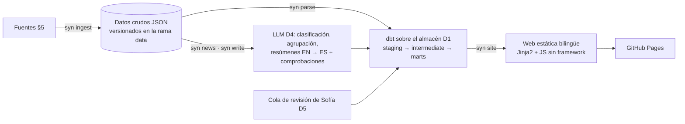

# SCOPE — SYNAPTICA

> **Fuente de verdad** de qué se hace, en qué orden y por qué. Si otro documento lo contradice, manda este. Los cambios se registran en §11.
>
> **Versión 29** · 2026-11-11 · creada a partir de la propuesta aprobada por Sofía (`docs/propuesta.md`).

## Índice

1. Visión
2. Objetivos
3. Dentro y fuera del alcance
4. Secciones de la web
5. Fuentes de datos
6. Arquitectura (propuesta)
7. Fases y entregables
8. Decisiones
9. Riesgos y mitigaciones
10. Backlog
11. Registro de cambios

## 1. Visión

**SYNAPTICA** («your Neuroscience hub» / «tu portal de neurociencia») es una web gratuita, en español e inglés, que cada día recoge lo nuevo de la neurociencia y lo explica de forma sencilla. A eso suma secciones para aprender cómo funciona el cerebro: un atlas 3D, técnicas de laboratorio, enfermedades, historia, experimentos y glosario.

Está pensada para dos públicos a la vez: gente curiosa sin formación y estudiantes. La firman Aday y Sofía.

**Posicionamiento.** El proyecto más parecido es [The Folded Mind](https://thefoldedmind.com/en/): atlas 3D del cerebro humano, biblioteca y boletín semanal, en turco e inglés y con enfoque de neuropsiquiatría clínica (diagnósticos, medicación, sistemas emocionales). SYNAPTICA se diferencia en:
- **Neurociencia básica y traslacional:** cómo se investiga el cerebro y qué se aprende en animales, no la clínica.
- **El puente rata ↔ humano** en Neuro Atlas: la misma región en los dos cerebros, con su grado de equivalencia y lo aprendido en cada especie.
- **Actualización diaria y automática**, en español e inglés.

Para no solaparse: nada de fichas de medicamentos, ni sistemas emocionales o cortes de resonancia como función principal; Neuro Diseases se centra en enfermedades neurológicas. Nunca se reutilizan sus textos ni su diseño. Aprobado por Sofía (v13).

## 2. Objetivos

**Producto.** Que Sofía tenga una web fiable de su campo que se mantenga sola. Cada frase sale de una fuente, y el contenido de salud pasa por su revisión.

**Portfolio de Aday (ingeniería de datos).**
- Demostrar que el motor de Paleo Atlas se generaliza: el mismo diseño, funcionando en otro dominio.
- Repetir dbt, Python, pytest y GitHub Actions, que ya aparecen en Paleo Atlas.
- Añadir lo que falta en el CV: un almacén en la nube (decisión D1) y, si se justifica con medidas, procesamiento a escala (D6).
- Evaluar con rigor: el clasificador de noticias se mide contra etiquetas puestas por Sofía, doctoranda en neurociencia.

**Métricas que se irán registrando:** artículos procesados por día, porcentaje de textos verificados, precisión del clasificador frente a Sofía, duración del pipeline diario y coste (0 €).

## 3. Dentro y fuera del alcance

**Dentro**
- Las 8 secciones de §4, en español e inglés.
- Actualización diaria automática de las noticias y de los bloques «lo último» de cada sección.
- Borradores automáticos de los textos fijos a partir de Wikipedia y Wikidata, con las comprobaciones de Paleo Atlas y la revisión de Sofía.

**Fuera** (no se hace salvo cambio registrado en §11)
- Consejo médico de cualquier tipo, recomendaciones de tratamiento, fichas de medicamentos y herramientas de autodiagnóstico.
- Reutilizar textos o diseño de otros proyectos (por ejemplo, The Folded Mind).
- Cuentas de usuario, comentarios públicos, publicidad y cualquier uso comercial.
- Copiar abstracts o textos completos de artículos de pago.
- Airflow, Docker y Snowflake.

## 4. Secciones de la web

| Sección | Qué es | Se actualiza sola | Revisión de Sofía | Fase |
|---|---|---|---|---|
| Neuro News | Noticias en tres bloques: Última hora, Nature · Science · Cell y Clásicos. Resumen semanal. | Sí (los Clásicos los aprueba ella) | Elige los Clásicos cada semana | 1 |
| Neuro Atlas | Cerebro humano y de rata en 3D; al tocar una región: qué hace, enfermedades relacionadas y últimos estudios. La misma región en los dos cerebros, lado a lado, con su grado de equivalencia; estudios en animales frente a estudios en humanos; técnicas con las que se estudia | Los estudios de cada región | Textos de cada región, correspondencia región → términos de búsqueda y **grado de equivalencia rata ↔ humano** | 2 |
| Neuro Lab | Técnicas: perfusiones, western blot, inmunofluorescencia, microscopía confocal, electrofisiología, EEG, fMRI, trazado con vectores virales, optogenética, DREADDs y quimiogenética, fiber photometry | Los estudios de ejemplo | Borradores de cada técnica | 2 |
| Neuro Glossary | Términos y siglas de la A a la Z, con buscador y enlaces a regiones, técnicas y enfermedades | No | Definiciones y siglas de su trabajo | 2 |
| Neuro Learn | Explicaciones cortas (neurona, sinapsis, sentidos, memoria, sueño…) y un apartado de neuromitos | No | Temas y borradores | 3 |
| Neuro Diseases | Fichas de enfermedades neurológicas (no un catálogo de diagnósticos psiquiátricos), línea del tiempo de estudios y ensayos clínicos abiertos en España | Estudios y ensayos | **Obligatoria** antes de publicar | 3 |
| Neuro History | Línea del tiempo desde Ramón y Cajal hasta hoy, con los Nobel relacionados | Cada Nobel nuevo | Hitos que no pueden faltar | 4 |
| Neuro Experiments | Ilusiones ópticas, pruebas en pantalla (tiempo de reacción, memoria…) y vídeos seleccionados | No | Propuestas de experimentos y vídeos | 4 |

Además, en todas las fases: dato curioso del día, página «Cómo elegimos y comprobamos las fuentes», «Estado de los datos», «Fuentes y licencias» y «Acerca de».

Las ideas nuevas van dentro de una sección existente, nunca como sección propia (es una condición de Sofía).

## 5. Fuentes de datos

En la Fase 0 se verifica el acceso, los límites, si hace falta clave y la licencia de cada fuente (spike S1); el resultado va a `docs/fuentes.md`.

| Fuente | Para qué | Fase |
|---|---|---|
| PubMed (E-utilities) | Estudios nuevos de neuro; estudios por región, técnica y enfermedad | 1 |
| Europe PMC | Texto completo en acceso abierto, para resúmenes más ricos | 1 |
| bioRxiv / medRxiv | Preprints, marcados como «sin revisar» | 1 |
| Nature, Science, Cell y revistas hermanas (Nature Neuroscience, Neuron…) | Bloque propio en Neuro News; solo metadatos y enlaces | 1 |
| SINC (sección Noticias), The Conversation, ScienceDaily (Neuroscience) | Noticias de divulgación en español e inglés | 1 |
| Crossref | Retractaciones, correcciones, tipo de publicación | 1 |
| OpenAlex | Recuento de citas para proponer los Clásicos | 1 |
| Wikipedia (ES/EN) y Wikidata | Borradores de los textos fijos, enfermedades por región, Nobel | 2–4 |
| Julich-Brain · siibra-explorer (EBRAINS) | Atlas humano (CC BY-NC-SA 4.0) y visor (Apache-2.0) | 2 |
| Waxholm Space, rata v4.01 | Atlas de rata (delineaciones CC BY 4.0; la RM de plantilla, CC BY-SA 4.0) | 2 |
| Allen Institute · BrainGlobe Atlas API | Alternativas y mallas 3D (licencias por confirmar) | 2 |
| ClinicalTrials.gov | Ensayos abiertos en España | 3 |
| nobelprize.org | Verificación de los Nobel y altas nuevas (ver si tiene API o se usa Wikidata) | 4 |
| Wikimedia Commons | Imágenes con licencia y autor | 1–4 |

## 6. Arquitectura (propuesta)

Se confirma en la Fase 0 con D1–D4 (cerradas D1, DuckDB + espejo en BigQuery, y D4, Groq + juez de otra familia). Sigue el diseño de Paleo Atlas.

- El estado vive en git. El almacén se reconstruye en cada ejecución, así que cualquier día es reproducible.
- Cada paso es un comando `syn`. GitHub Actions los ejecuta a diario, con una detección de cambios barata primero y una ejecución de respaldo.
- Cada ejecución deja un informe en la rama `data`.

## 7. Fases y entregables

Cada fase se cierra con el **visto bueno de Sofía** y con `docs/fases/fase-N.md`: el porqué, los conceptos, cómo se comprueba, qué salió mal y cómo defenderlo en una entrevista. Al acabar cada fase la web sigue publicada, aunque falten secciones.

### Fase 0 — Cimientos

- [x] Repositorio `synaptica` en local y en GitHub (visibilidad: D9)
- [x] `pyproject.toml` (uv, Python 3.14, ruff, pytest), `.gitignore`, `.editorconfig`, `.python-version`
- [x] CLI `syn` mínima (typer) con `syn --version` y `syn doctor`, que comprueba el entorno y las variables necesarias
- [x] CI (`ci.yml`): ruff y pytest sin red en cada push y PR
- [x] `LICENSE` (AGPL-3.0) y `LICENSE-CONTENT.md` (CC BY-SA 4.0 para los textos propios; terceros con su licencia), según §8
- [x] `README.md` y `README.es.md` mínimos
- [x] `docs/adr/README.md` con plantilla y `docs/fases/README.md`
- [x] `docs/propuesta.md`, exportada del documento aprobado
- [x] **S1 Fuentes:** script mínimo por fuente que descarga unos 10 elementos, guardados como fixtures, y `docs/fuentes.md` con acceso, límites, clave y licencia
- [x] **S2 Almacén:** prueba de BigQuery sandbox desde GitHub Actions con dbt-bigquery → ADR de D1
- [ ] **S3 Visor 3D:** dos maquetas (three.js con mallas propias y Niivue con volúmenes propios; siibra-explorer embebido, medido y descartado) con los dos atlas lado a lado y regiones clicables por ID, en GitHub Pages; entre las que cumplan D3 elige Sofía ([plan](spikes/s3/PLAN.md)) → ADR de D3. Hechos los pasos 0 (preparación), 1 (datos y licencias, [resultados](spikes/s3/results/README.md)), 2 (maqueta A, descartada: [resultados](spikes/s3/results/maqueta-a.md)), 3 (datos para B y C, [resultados](spikes/s3/results/README.md#s3--paso-3-datos-para-las-maquetas-b-y-c)), 4 (maqueta B, `spikes/s3/site/b/`), 5 (maqueta C, `spikes/s3/site/c/`) y 6 (mediciones: [B](spikes/s3/results/maqueta-b.md), [C](spikes/s3/results/maqueta-c.md))
- [ ] **S4 Revisión:** prototipo del flujo de revisión probado con Sofía ([plan](spikes/s4/PLAN.md)) → ADR de D5
- [x] **S5 LLM:** límites actuales del plan gratuito de Groq y de Ollama local, y elección de un juez de otra familia de modelos para el contenido de salud → ADR de D4

**Cierre:** CI en verde, D1, D3, D4 y D5 cerradas con su ADR, y `docs/fuentes.md` completo.

### Fase 1 — La base

- [ ] Ingesta de las fuentes de la Fase 1 (§5) en la rama `data`, con caché y respeto de límites
- [ ] Modelos dbt con tests: claves, valores aceptados, relaciones y frescura de cada fuente
- [ ] Filtro «¿es neurociencia?» para las revistas generalistas
- [ ] Clasificación por tipo (cerebro sano, enfermedades, ensayos clínicos, técnicas, ruido), evaluada contra unos 100 titulares etiquetados por Sofía y un baseline clásico
- [ ] Agrupación de la misma noticia entre medios e idiomas
- [ ] Resúmenes EN → ES con las comprobaciones de texto
- [ ] Repetir la cadena de S5 con los prompts v2 (Groq, y Qwen 9B cuando la GPU de Aday quede libre) y comprobaciones nuevas (ortografía en español, frases de alarma, cautelas), comparando con la revisión de Sofía ([ADR D4](docs/adr/0004-llm.md))
- [ ] Juez de otra familia (D4) y carga inicial de resúmenes con el modelo local de Aday, cuando el PC quede libre de los lotes de Paleo; después, Groq en Actions
- [ ] Señales de cada estudio: revisión por pares o preprint, humanos o animales, retractado o corregido
- [ ] Bloques Última hora · Nature, Science y Cell · Clásicos (propuesta semanal por citas en OpenAlex y aprobación de Sofía)
- [ ] Resumen semanal
- [ ] Web: portada y diseño, aviso médico, dato curioso del día, Cómo evaluamos, Estado de los datos, Fuentes y licencias, Acerca de; bilingüe y con `syn site --check`
- [ ] `pipeline.yml`: ejecución diaria con detección de cambios, respaldo e informe
- [ ] Espejo semanal de los marts en BigQuery sandbox (D1), con su consumo de cupo medido en el informe

**Cierre:** 14 días seguidos de ejecución autónoma sin intervención, visto bueno de Sofía y `fase-1.md`.

### Fase 2 — Prioridades de Sofía

- [ ] **Neuro Atlas:** humano (Julich-Brain) y rata (Waxholm) en 3D según D3, cada atlas por separado y con su licencia
  - [ ] **Introducción:** diferencias generales entre el cerebro humano y el de rata (girencéfalo frente a lisencéfalo, proporciones, etc.), con la cadena de textos y revisada por Sofía
  - [ ] Orden de las regiones: primero las estructuras de la superficie y después las internas (hipocampo, amígdala…), según propone Sofía
  - [ ] Cada región con nombre y código oficial; al tocarla, descripción, enfermedades relacionadas (Wikidata) y últimos estudios
  - [ ] Tabla región → términos de búsqueda y sinónimos para PubMed, revisada por Sofía
  - [ ] **Rata ↔ humano:** tabla de correspondencias entre regiones de Waxholm y de Julich-Brain con grado de equivalencia (clara, parcial o discutida) y una nota breve, puesta por Sofía; vista lado a lado de la misma región en los dos atlas, sin mezclar sus datos (licencias distintas)
  - [ ] **Qué hemos aprendido en animales:** en cada región, estudios en roedores y estudios en humanos por separado, con las etiquetas de §4
  - [ ] **Técnica ↔ región:** desde cada región, las técnicas de Neuro Lab con las que se estudia; desde cada técnica, las regiones donde se usa (a partir de los estudios clasificados)
- [ ] **Neuro Lab:** una ficha por técnica de §4 (qué permite ver, límites y estudios recientes que la usan)
- [ ] **Neuro Glossary:** términos y siglas de la A a la Z, buscador y enlaces cruzados; semilla con los 16 términos de la propuesta y borradores desde Wikipedia

**Cierre:** visto bueno de Sofía y `fase-2.md`.

### Fase 3 — Aprender

- [ ] **Neuro Learn:** temas elegidos por Sofía y el apartado de neuromitos
- [ ] **Neuro Diseases:** fichas (lista de Sofía), línea del tiempo de estudios y ensayos abiertos en España; publicación bloqueada sin aprobación registrada
- [ ] Enlaces cruzados Atlas ↔ Diseases ↔ Glossary ↔ News

**Cierre:** visto bueno de Sofía y `fase-3.md`.

### Fase 4 — Para explorar

- [ ] **Neuro History:** línea del tiempo interactiva; la tabla de Nobel de la propuesta como semilla, verificada; altas automáticas de Nobel nuevos con filtro neuro y aprobación; hitos no Nobel elegidos por Sofía
- [ ] **Neuro Experiments:** ilusiones y pruebas en JS sin framework, cada una con explicación verificada; vídeos insertados con permiso de inserción
- [ ] Comparador de cerebros dentro de Neuro Atlas, solo si hay datos fiables y con licencia (si no, se queda en el backlog)

**Cierre:** visto bueno de Sofía y `fase-4.md`.

## 8. Decisiones

### Cerradas

| Decisión | Motivo |
|---|---|
| Nombre SYNAPTICA, a nombre de Aday y Sofía | Elegido por Sofía (dominio pendiente: D7) |
| Español e inglés desde el principio | Respuesta de Sofía; mismo patrón que Paleo Atlas |
| 8 secciones de §4 y orden de fases de §7 | Propuesta aprobada; las prioridades de Sofía van en la Fase 2 |
| La sección del atlas se llama «Neuro Atlas» | «Brain Explorer» figura como marca del Allen Institute |
| Se aceptan licencias NC | Decisión de Aday: la web es gratuita y no comercial |
| 0 € al mes | Mismo principio que Paleo Atlas |
| Revisión obligatoria de Sofía en Neuro Diseases | Contenido de salud |
| Textos fijos como borradores desde Wikipedia que Sofía corrige | Aprobado por Sofía; tiene 1 h al día |
| Python + dbt + GitHub Actions + Pages; estado en git | Se repite el motor de Paleo Atlas |
| Sin Airflow, Docker ni Snowflake | Los dos primeros ya están demostrados; Snowflake no es gratis |
| Posicionamiento frente a The Folded Mind (§1): neurociencia básica y traslacional, puente rata ↔ humano, sin medicación | Propuesto por Aday y aprobado por Sofía; aprovecha su investigación en roedores y evita duplicar un proyecto clínico |
| Licencias: código AGPL-3.0; textos propios CC BY-SA 4.0; material de terceros con la suya (NC incluidas) | El código comparte motor con Paleo Atlas (AGPL), y una licencia más abierta anularía esa protección. Los textos parten de Wikipedia (CC BY-SA) y así pueden reutilizarse e incluso volver a ella. Los textos nunca incorporan material de los atlas NC. |
| Repositorio público en GitHub; Sofía no es colaboradora por ahora | Por el portfolio, y en público Actions no tiene límite de minutos y Pages es gratis. Sofía entra como colaboradora solo si el flujo de revisión (D5) lo necesita |
| D1 · Almacén: DuckDB reconstruido cada día; espejo semanal de los marts en BigQuery sandbox (load jobs, WIF) | S2: el sandbox funciona sin tarjeta, pero su cupo de 10 GiB es de por vida y no se recupera al borrar, así que no aguanta una reconstrucción diaria. El espejo suma BigQuery al CV sin poner en riesgo el pipeline ([ADR D1](docs/adr/0001-almacen.md)) |
| D4 · LLM: carga inicial con el modelo local de Aday (Qwen 9B en Ollama); después, Groq gratis en Actions con redactor `qwen3.8-27b` y juez `gpt-oss-120b` (otra familia) | S5: Groq da unos 40–60 resúmenes al día por modelo, y el juez de otra familia cazó 3 errores reales que las comprobaciones dejaban pasar. La carga inicial va en local para no gastar cupo; se hace cuando terminen los lotes de Paleo ([ADR D4](docs/adr/0004-llm.md)) |

### Abiertas

| ID | Decisión | Opciones | Recomendación inicial |
|---|---|---|---|
| D2 | Motor común con Paleo Atlas | Copiar y adaptar · extraer un paquete compartido | Copiar y adaptar ahora; extraer el paquete solo cuando ambos sean estables |
| D3 | Visor 3D | siibra-explorer embebido o autohospedado (embebido: descartado en S3) · three.js con mallas de BrainGlobe · Niivue con volúmenes propios · otro | Lo decide S3: tiene que funcionar en GitHub Pages sin backend propio, con regiones clicables por ID, licencias compatibles, un peso razonable en móvil y **los dos atlas a la vez, lado a lado** (vista rata ↔ humano) |
| D5 | Flujo de revisión de Sofía | Editar en la web de GitHub · formulario de GitHub Issues · página de revisión generada · hoja de cálculo | Prototipo en S4 probado con ella. Requisitos: sin terminal, sin git y menos de 1 h al día. Cubre la revisión de textos y también la tabla rata ↔ humano: poner y cambiar el grado de equivalencia (clara, parcial o discutida) y su nota. La página de revisión de S5, que ella usó sin terminal ni git, cuenta como primera prueba de la opción «página de revisión generada». Sofía no tiene cuenta de GitHub; se la crea si el prototipo elegido la necesita |
| D6 | Procesamiento a escala | Databricks Free Edition para una carga histórica de PubMed · solo APIs | Solo si el volumen lo justifica y se mide, como en el ADR D5 de Paleo. Si no, basta OpenAlex |
| D7 | Dominio | Dominio propio · `adaycuestacorrea.github.io/synaptica` | Empezar en GitHub Pages y comprobar el nombre antes de registrar nada (ya existe Synaptica B.V., una empresa neerlandesa de neurociencia computacional) |

## 9. Riesgos y mitigaciones

| Riesgo | Mitigación |
|---|---|
| El tiempo de Sofía (1 h al día) se convierte en un cuello de botella | Cola de revisión priorizada; solo Neuro Diseases bloquea la publicación |
| El tiempo de Aday: las candidaturas de empleo van primero | Fases cortas y la web siempre publicada; ninguna fase depende de una fecha |
| ~~Nature, Science o Cell sin un canal público útil~~ **Mitigado** (S1, 2026-11-09) | Los 7 RSS de las revistas y sus hermanas funcionan y traen DOI; Crossref por ISSN queda de respaldo (ISSN impreso para Cell Press). Ver `docs/fuentes.md` |
| Visor 3D pesado o imposible sin backend | S3 en la Fase 0, antes de comprometer la Fase 2 |
| Los nombres de las regiones dan resultados ambiguos en PubMed | Tabla de sinónimos revisada por Sofía y tests con ejemplos |
| La tabla de equivalencias rata ↔ humano consume demasiado tiempo de Sofía | Empezar por las regiones de su investigación y las más consultadas; el resto se muestra sin vista comparada hasta que tenga su grado |
| Cambian los límites de los planes gratuitos (LLM, APIs) | Caché, ejecución por lotes y degradación al texto de respaldo. Ya pasó: Groq retiró Llama del plan gratuito (S5). Los papeles de redactor y juez se pueden intercambiar entre las dos familias que quedan, y Ollama recupera los atrasos |
| GitHub retrasa o se salta las ejecuciones programadas | Ejecución de respaldo y detección de cambios, como en Paleo |

## 10. Backlog

Ideas sin aprobar; entran en una fase solo con una línea en §11.

- Comparador de cerebros entre especies, si no entra en la Fase 4.
- Resumen semanal por correo.

## 11. Registro de cambios

| Versión | Fecha | Cambio |
|---|---|---|
| 1 | 2026-11-09 | Creación a partir de la propuesta aprobada por Sofía |
| 2 | 2026-11-09 | D8 cerrada: código AGPL-3.0 y textos propios CC BY-SA 4.0 |
| 3 | 2026-11-09 | Andamiaje de la Fase 0 hecho (repo, pyproject, CLI `syn` con `--version` y `doctor`, CI, licencias, README, índices de ADR y fases); D9 cerrada: repositorio público, Sofía no es colaboradora hasta que D5 lo pida |
| 4 | 2026-11-09 | Nuevo spike S5 (LLM) para cerrar D4, que el cierre de la Fase 0 exige y ningún spike cubría; D5 anota que Sofía no tiene cuenta de GitHub; GitHub Pages activado (origen: GitHub Actions) |
| 5 | 2026-11-09 | S1 en curso: `docs/fuentes.md` con 15 fuentes medidas y fixtures sin texto de editores; los RSS de Nature, Science y Cell funcionan; pendientes SINC (caído), algunos límites y los atlas (en S3) |
| 6 | 2026-11-09 | §9: riesgo «Nature, Science o Cell sin canal público» mitigado según S1 |
| 7 | 2026-11-09 | S2 hecho: BigQuery sandbox funciona desde Actions sin tarjeta ni clave (WIF), pero tiene un cupo de almacenamiento de 10 GiB de por vida que no se recupera al borrar, incompatible con reconstruir el almacén cada día. ADR D1 en propuesta (recomendación: DuckDB + espejo semanal de los marts en BigQuery) |
| 8 | 2026-11-09 | D1 cerrada (opción C): DuckDB como almacén y espejo semanal de los marts en BigQuery; tarea del espejo añadida a la Fase 1 |
| 9 | 2026-11-10 | S5 hecho: límites de Groq medidos (1000 RPD y 8000 TPM por modelo; 200 000 TPD documentado; sin Llama), Qwen 9B local a 122 tokens/s y la cadena de Paleo probada con 10 artículos de PubMed (8–9 de 10 publicables; el juez de otra familia cazó 3 errores reales que las comprobaciones dejaban pasar). ADR D4 en propuesta (recomendación: opción A); D4 sigue abierta |
| 10 | 2026-11-10 | D4 cerrada (opción A): carga inicial con el modelo local de Aday cuando terminen los lotes de Paleo, y después Groq en Actions con juez de otra familia. Revisión de una muestra de resúmenes preparada para Sofía |
| 11 | 2026-11-10 | Revisión ciega de Sofía de los resúmenes de S5 (20 versiones): Qwen 9B y Qwen 27B empatan en contenido (los prefiere 4 y 5 veces) y en los dos el español es el punto débil. El juez coincide con ella en 17 de 19 casos (kappa ≈ 0,60): deja pasar una exageración y rechaza una versión que ella da por buena. D4 no cambia; cifras en la sección «Revisión» del [ADR D4](docs/adr/0004-llm.md) |
| 12 | 2026-11-10 | Prompts de S5 en v2 según la revisión de Sofía (diseño del estudio, lista de exageraciones, término técnico con explicación, español natural; nota `spanish_natural` del juez, que no bloquea). La nueva ejecución queda pendiente, como tarea de la Fase 1 |
| 13 | 2026-11-11 | Posicionamiento frente a The Folded Mind (§1), aprobado por Sofía: en la Fase 2 entran la vista rata ↔ humano con grado de equivalencia, «qué hemos aprendido en animales» y los enlaces técnica ↔ región; D3 exige los dos atlas lado a lado; Neuro Diseases se centra en enfermedades neurológicas; fuera del alcance, fichas de medicamentos y reutilizar textos o diseño ajenos |
| 14 | 2026-11-11 | D5: el flujo de revisión también tiene que cubrir la tabla de equivalencias rata ↔ humano (grado y nota); la página de revisión de S5 cuenta como primera prueba de la opción «página de revisión generada» |
| 15 | 2026-11-11 | Plan de S3 ([`spikes/s3/PLAN.md`](spikes/s3/PLAN.md)): dos maquetas lado a lado (siibra-explorer y three.js) en GitHub Pages, y elige Sofía; regiones de prueba: una de superficie y el hipocampo. Fase 2, a propuesta de Sofía: introducción a las diferencias entre el cerebro humano y el de rata, y regiones de la superficie antes que las internas |
| 16 | 2026-11-11 | S3, pasos 0 y 1: grupo `spike-s3` (brainglobe-atlasapi, siibra, trimesh) y medidas de los dos atlas ([resultados](spikes/s3/results/README.md)). Waxholm es v4.01 (224 regiones, mallas de 16,8 MB sin comprimir) y Julich-Brain v3.1 (MPM de 1 mm, sin mallas: hay que generarlas). Las tres regiones de prueba existen en los dos atlas; la amígdala de Waxholm no está subdividida. `docs/fuentes.md` completa la línea de los atlas, lo último de S1. **Por decidir:** las delineaciones de Waxholm son CC BY 4.0, no CC BY-SA como dicen §5, CLAUDE.md, la propuesta y el plan (solo la RM de plantilla es CC BY-SA); no se ha corregido en esos documentos |
| 17 | 2026-11-11 | Licencia de Waxholm corregida a CC BY 4.0 en §5, CLAUDE.md, la propuesta y el plan de S3, según el EBRAINS KG (v4 y v4.01) y NITRC; la RM de plantilla es CC BY-SA 4.0. Se mantiene la regla de no combinar los dos atlas en un mismo dato derivado |
| 18 | 2026-11-11 | CLAUDE.md: los textos propios de Paleo Atlas (CC BY-NC-SA) no se copian a SYNAPTICA (CC BY-SA), se reescriben; el código se sigue copiando (AGPL en los dos) |
| 19 | 2026-11-11 | S3, paso 2 ([maqueta A](spikes/s3/results/maqueta-a.md)): siibra-explorer se deja embeber y abre con una región seleccionada desde la URL, pero no avisa a la página que lo embebe; solo un plugin propio (`?pl=`), que el usuario tiene que aprobar en cada visita, podría reenviar el clic, y no se ha podido probar sin publicarlo en HTTPS. 6,8 MB de código antes de los datos, interfaz de escritorio en móvil y Matomo de EBRAINS activado por defecto |
| 20 | 2026-11-11 | Plan de S3 cambiado ([`spikes/s3/PLAN.md`](spikes/s3/PLAN.md)): la maqueta A (siibra-explorer) queda descartada y la sustituye la C, Niivue 0.69.0 con volúmenes propios; Sofía elegirá entre B (three.js) y C. Nuevo paso común de datos para las dos y requisito añadido: sin ventanas, sin seguimiento y sin otros dominios en tiempo de uso. Pages pasa a ser el paso 7 |
| 21 | 2026-11-11 | S3, paso 3: `spikes/s3/build_assets.py` genera, por atlas y sin mezclarlos, un glTF con Draco (B), un NIfTI de etiquetas (C), la tabla de nombres y colores y la licencia con su cita; unos 0,8 MB por atlas. Waxholm a 117 µm, con protección de regiones pequeñas (decisión de Aday: sin ella se pierde CC L). Julich-Brain distingue los hemisferios por archivo (lh/rh), no por coordenada. `equivalencias.json` de prueba con el grado «pendiente de Sofía». Dependencias declaradas en `spike-s3`: dracopy, fast-simplification, nibabel, scikit-image y scipy |
| 22 | 2026-11-11 | S3, paso 4: maqueta B (three.js 0.187.0 y su decodificador Draco, guardados en `spikes/s3/site/vendor/` con sus licencias). Dos lienzos (uno encima del otro en móvil); al hacer clic, panel con ID y lado, resaltado de la equivalente en el otro atlas con el grado «pendiente de Sofía», y botones para ocultar el contorno o aislar la región. Corregidos en `build_assets.py`: el corte de las mallas de rata por lado (cara a cara) y la orientación de las caras. Es + en, con `?lang=en` |
| 23 | 2026-11-11 | S3, paso 5: maqueta C (Niivue 0.69.0, guardado en `spikes/s3/site/vendor/` con su licencia, que el paquete de npm no trae). Con el mismo comportamiento que B, más dos vistas (solo 3D, y 3D con un corte coronal), recortar y aislar. Hubo que sortear dos cosas de Niivue: en 3D solo lee el vóxel con doble clic (un clic simple le manda ese doble clic), y con unas 450 etiquetas su tabla de colores pintaba el fondo con la etiqueta 3 (se suben las etiquetas 8 valores al cargar, solo en el visor) |
| 24 | 2026-11-11 | S3, paso 6: mediciones de B y C en un móvil emulado (Slow 4G, CPU ×4, táctil) con `spikes/s3/measure.mjs`. Con gzip, como en Pages: B pesa 1,07 MB y se puede usar a los 10 s; C, 1,91 MB y 16 s. Las dos funcionan con el dedo y no piden nada a otros dominios. Fluidez con WebGL por software: B, 20 fps; C, 3 fps a DPR 3 y 22 fps con `?dpr=1`. Falta probar las dos en un móvil real |
| 25 | 2026-11-11 | S1 hecho. SINC vuelve a responder y se usa su sección *Noticias* (decisión de Aday): unos 1,2 items de neuro por semana, incluye casi todo lo de Salud y añade la neuro animal de *Tierra*. medRxiv psiquiatría: 34 preprints en 7 días al paginar; las semanas pasadas crecen días después y cada versión es una entrada aparte (habrá que volver atrás y deduplicar por DOI). Límites: solo Europe PMC da uno (10/s, en su foro); bioRxiv, ClinicalTrials.gov y nobelprize.org no publican ninguno y ninguna envía cabeceras. Licencias: Nobel CC0; ClinicalTrials.gov pide atribución y fecha de proceso. Nuevo `tests/test_fixtures.py`: las fixtures parsean y no guardan texto de editores. Los scripts de S1 envían un User-Agent genérico, sin correo. Corrige la v16: los atlas no eran lo último de S1, quedaban SINC y los límites |
| 26 | 2026-11-11 | Plan de S4 ([`spikes/s4/PLAN.md`](spikes/s4/PLAN.md)): inventario de lo que revisa Sofía y opciones de D5 comparadas; recomendación: página de revisión generada con envío como Issue de GitHub, y Google Sheets de reserva. Decisiones de Aday: Sofía tendrá cuenta de GitHub sin ser colaboradora (D9 no cambia); los borradores de Neuro Diseases no van a la página pública; las decisiones van en Issues públicos, con la nota opcional; sus correcciones pasan otra vez las comprobaciones mecánicas y el juez solo como aviso. D5 sigue abierta. §2: Sofía es doctoranda, no «una experta» |
| 27 | 2026-11-11 | S4, paso 1: modelo de la cola de revisión y de las decisiones de Sofía (`spikes/s4/models.py`, pydantic en el grupo nuevo `spike-s4`) y fixtures en `tests/fixtures/review/` hechas con material del repositorio, sin inventar contenido de salud. La aprobación se ata al hash del contenido. Queda abierto para el paso 4 qué hacer con el inglés cuando ella corrige solo el español (también en la nota del grado). Plan: añadida la revisión opcional de resúmenes publicados (ADR D4) |
| 28 | 2026-11-11 | S4, paso 2: página de revisión generada desde la cola (`spikes/s4/review_page.py`), en dos variantes que nunca se mezclan: pública (todo menos Neuro Diseases) y privada (solo Neuro Diseases, como archivo). Ordenada por prioridad, con las respuestas guardadas en el navegador y atadas al hash, sin peticiones a otros dominios. Probada en Chrome con decisiones que valida el modelo de Python. El envío llega en el paso 3 |
| 29 | 2026-11-11 | S4, paso 3: la página de revisión envía sus decisiones abriendo el formulario de Issue `revision.yml` ya relleno (subido a `main` con la etiqueta `revisión`, con permiso de Aday). Medido: sin sesión iniciada, GitHub falla por encima de unos 6950 caracteres de URL (500 y después 414), así que la página usa 6000 y reparte en varios Issues; una ficha corregida entera se pega a mano. Falta un envío real de punta a punta, que hará Aday: la extensión de Chrome se bloqueó con las URL largas ([resultados](spikes/s4/results/README.md)) |
